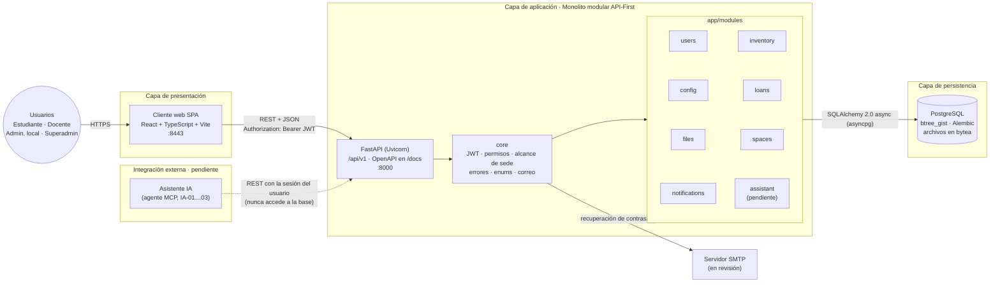
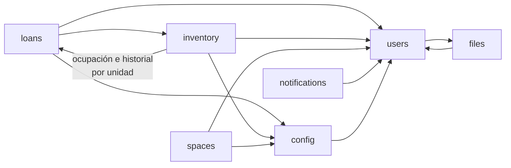

# Arquitectura del sistema

> **Estado:** refleja `develop` de Backend y Frontend al 2026-11-09. Lo que está en un PR abierto se marca como *en revisión*; lo que no tiene código, como *pendiente*.
> **Diseño original:** [historico/arquitectura-v1.webp](historico/arquitectura-v1.webp) (Figura 8 del ERS, Iteración 4).

## Diagrama

### Dependencias entre módulos

Cada módulo expone funciones de servicio públicas y no lee las tablas de otro. Las flechas indican "importa de":

`config` provee los parámetros operativos (`obtener_parametro`: horario, plazos, anticipación) y `users` los datos públicos de los solicitantes. La dependencia de `inventory` hacia `loans` es de lectura (disponibilidad por fechas, SPEC-04 Fase B).

## Capas

| Capa | Hoy | Notas |
| --- | --- | --- |
| Presentación | SPA en React 19 + TypeScript + Vite, organizada por *feature* (`src/features/<dominio>`). Pantallas en `develop`: login, registro, recuperación y cambio de contraseña, perfil, usuarios, parámetros, catálogo, stock y espacios | Préstamos (`feat/loans-solicitudes`) y novedades (frontend PR \#12) en ramas sin mergear |
| Aplicación | FastAPI asincrónico; un router por módulo montado en `app/main.py` con prefijo `/api/v1/<modulo>`. Kernel compartido en `app/core/` | Errores de negocio como `{detail, code}` (`AppError`) |
| Persistencia | PostgreSQL con migraciones manuales de Alembic (`0001`…`0014` en `develop`) | Integridad temporal con `EXCLUDE USING gist` en préstamos y reservas; los archivos (foto, aval PDF) se guardan en `archivos_contenido` |
| Integración externa | Sin implementar | El asistente consume la misma API REST que el cliente web (IA-02, IA-03) |

## Seguridad

- **Autenticación:** JWT firmado (`JWT_SECRET_KEY`, obligatoria). La renovación deslizante con tope absoluto y el cierre de sesiones (`/auth/renovar`, `/auth/me/sesiones/cerrar`) están en revisión (SPEC-03 B3). Revocación por `usuarios.token_version`.
- **Autorización:** `require_roles(...)` por endpoint y `resolver_alcance_sede(...)` para el aislamiento Ushuaia / Río Grande (GLO-01). El `SUPERADMIN` ve ambas sedes; el resto, sólo la propia.
- **Contraseñas:** Argon2 (`pwdlib`). Tokens de recuperación guardados como SHA-256.

## Diferencias con el diseño original

| Diseño original (v1) | Implementación actual |
| --- | --- |
| Cuatro módulos: `loans`, `users`, `inventory`, `spaces` | Siete módulos más el kernel `core`: se sumaron `config` (GLO-03), `files` (foto de perfil y aval PDF) y `notifications` (NOV-01…04). `assistant` sigue pendiente |
| El backend recibe una "confirmación transaccional" de la base como flujo aparte | Es la misma conexión: cada request abre una sesión async y confirma o revierte. Los conflictos de concurrencia llegan como `IntegrityError` y se traducen a `409` |
| Agente IA que "consume contratos OpenAPI" | Se mantiene, con la aclaración de que actúa con la sesión del usuario y nunca accede a la base (Constitución, AGENTS.md §7) |
| Hosting sugerido: Vercel/Netlify y Render/Railway | **Pendiente de decisión.** El despliegue (Docker, CI) es del Perfil 1 (ADR-018) y todavía no tiene spec |
| Sin correo | Envío por SMTP para la recuperación de contraseña (USR-02, en revisión) y, más adelante, para notificaciones |

## Cómo actualizar este documento

Los diagramas están en Mermaid: GitHub los dibuja al ver el archivo y se editan como texto. Al mergear un módulo o una integración nueva, actualizar el diagrama, la tabla de capas y la línea de **Estado**.
