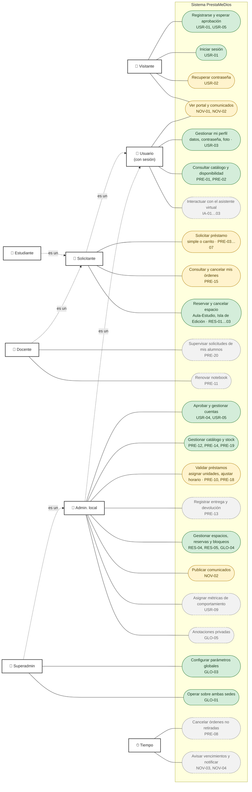

# Casos de uso

> **Estado:** refleja `develop` de Backend y Frontend al 2026-11-09.
> **Diseño original:** [historico/casos-de-uso-v1.png](historico/casos-de-uso-v1.png) (Figura 1 del ERS). Los casos de uso detallados (flujos, precondiciones) siguen en `docs/ERS.md`; acá está el mapa general y qué parte existe en el código.

## Diagrama

Mermaid no tiene diagrama de casos de uso UML: los actores van a la izquierda y los casos de uso como óvalos. El color indica el estado.

| Color | Significado |
| --- | --- |
| Verde | Implementado de punta a punta en `develop` |
| Amarillo | Parcial: backend en `develop` sin pantalla, o al revés, o en un PR abierto |
| Gris punteado | Pendiente: sin código |

## Detalle por caso de uso

| Caso de uso | Requisitos | Actor | Backend | Frontend |
| --- | --- | --- | --- | --- |
| Registrarse y esperar aprobación | USR-01, USR-05 | Visitante | `POST /auth/register` | Registro |
| Iniciar sesión | USR-01 | Visitante | `POST /auth/login` (renovación y cierre de sesiones en revisión, SPEC-03 B3) | Login |
| Recuperar contraseña | USR-02 | Visitante | En revisión (PR \#27): `/auth/recuperacion`, `/auth/recuperacion/confirmar` | Pantallas en `develop` |
| Ver portal y comunicados | NOV-01, NOV-02 | Visitante, Usuario | `GET /notifications/comunicados` | En revisión (frontend PR \#12) |
| Gestionar mi perfil | USR-03 | Usuario | `GET/PATCH /auth/me`, `/auth/me/password`, `/auth/me/foto` | Perfil |
| Consultar catálogo y disponibilidad | PRE-01, PRE-02 | Usuario | `GET /inventory/equipamiento`, `…/{id}/disponibilidad` | Catálogo |
| Interactuar con el asistente virtual | IA-01…03 | Usuario | Pendiente (`assistant`) | Pendiente |
| Solicitar préstamo | PRE-03…07 | Estudiante, Docente | `GET /loans/reglas`, `POST /loans/ordenes`; aval PDF de alta gama en integración (`files`) | Rama `feat/loans-solicitudes`, sin mergear |
| Consultar y cancelar mis órdenes | PRE-15 | Estudiante, Docente | `GET /loans/ordenes/mias`, `PATCH /loans/ordenes/{id}/estado` (sólo `pendiente`) | Pendiente |
| Reservar y cancelar espacio | RES-01…03 | Estudiante, Docente | `GET /spaces/disponibilidad`, `POST /spaces/reservas`, `PATCH …/estado` | Espacios |
| Supervisar solicitudes de mis alumnos | PRE-20 | Docente | Pendiente: no existe el módulo de asignaturas (`asignatura_id` sin FK) | Pendiente |
| Renovar notebook | PRE-11 | Solicitante | Pendiente (`es_renovado` existe, sin flujo) | Pendiente |
| Aprobar y gestionar cuentas | USR-04, USR-05 | Admin. local | `GET/POST /users`, `PATCH /users/{id}`, `PATCH /users/{id}/estado` | Usuarios |
| Gestionar catálogo y stock | PRE-12, PRE-14, PRE-19 | Admin. local | `/inventory/equipamiento`, `/inventory/unidades`, `/inventory/categorias` | Catálogo, Stock |
| Validar préstamos | PRE-10, PRE-18 | Admin. local | `GET /loans/ordenes` (bandeja), `…/unidades-libres`, `PATCH …/estado` | Pendiente |
| Registrar entrega y devolución | PRE-13 | Admin. local | Pendiente | Pendiente |
| Gestionar espacios, reservas y bloqueos | RES-04, RES-05, GLO-04 | Admin. local | `POST /spaces/espacios`, `PATCH /spaces/reservas/{id}/estado`, `/spaces/bloqueos` | Espacios |
| Publicar comunicados | NOV-02 | Admin. local | `POST/PATCH /notifications/comunicados` | En revisión (frontend PR \#12) |
| Asignar métricas de comportamiento | USR-09 | Admin. local | Pendiente | Pendiente |
| Anotaciones privadas | GLO-05 | Admin. local | Pendiente | Pendiente |
| Configurar parámetros globales | GLO-03 | Superadmin (los admin. locales sólo consultan el historial) | `GET/PUT /config/parametros/{clave}` | Parámetros |
| Operar sobre ambas sedes | GLO-01 | Superadmin | `resolver_alcance_sede` en todos los módulos | Selector de sede |
| Cancelar órdenes no retiradas | PRE-08 | Tiempo | Pendiente (estado `no_retirado` ya existe) | — |
| Avisar vencimientos y notificar | NOV-03, NOV-04 | Tiempo | Pendiente (tabla `notificaciones` creada, SPEC-06 Fase B) | Pendiente |

Todas las rutas cuelgan de `/api/v1`.

## Diferencias con el diagrama original

- **Actores:** el original agrupaba a todos los administradores. Ahora se distinguen **Admin. local** (su sede) y **Superadmin** (ambas sedes y parámetros globales), y aparece **Visitante** para lo que no requiere sesión. Se suma **Tiempo** para los procesos automáticos.
- **Reservar espacio:** el original lo limitaba a la Isla de Edición. Hoy cualquier estudiante o docente puede reservar cualquier espacio de su sede (Aula-Estudio o Isla de Edición), sujeto a aprobación (RES-05).
- **Monitorear solicitudes de alumnos:** sigue en el diseño (PRE-20), pero depende de un módulo de asignaturas que no existe.
- **Registrar entrega y devolución** y **Asignar métricas de comportamiento** se mantienen, pero sin código todavía.
- **Gestionar comunicados** pasó a ser "Publicar comunicados" (admin) más "Ver portal y comunicados" (todos).
- Se suman **Recuperar contraseña**, **Gestionar mi perfil**, **Consultar catálogo y disponibilidad**, **Configurar parámetros** y **Operar sobre ambas sedes**, que el original omitía o agrupaba.

## Cómo actualizar este documento

Cuando un caso de uso cambia de estado, cambiar su clase en el diagrama (`:::hecho`, `:::parcial`, `:::pendiente`) y su fila en la tabla. Un caso nuevo necesita un requisito en el ERS que lo respalde.
