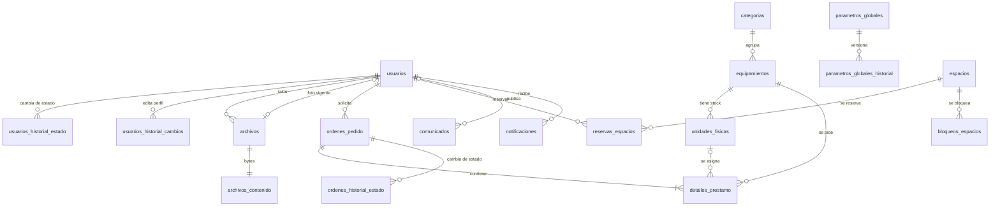
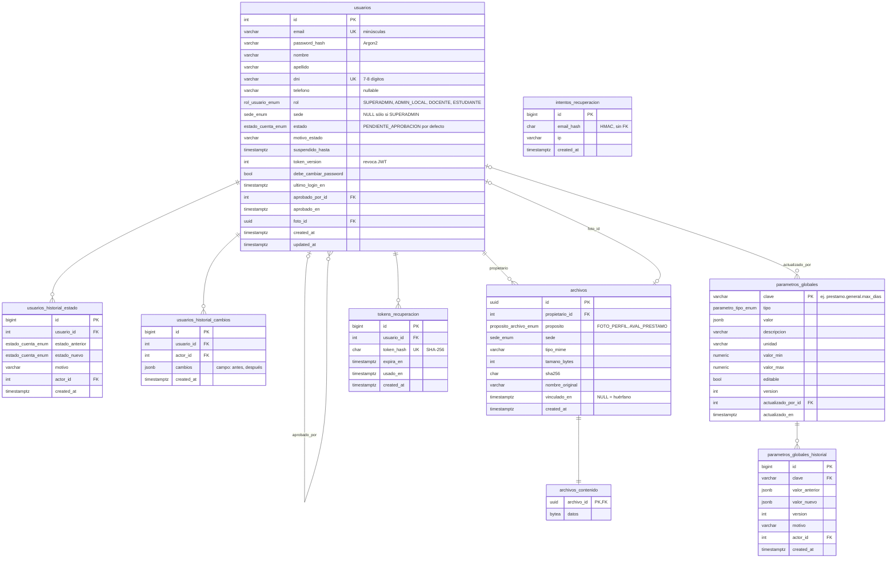
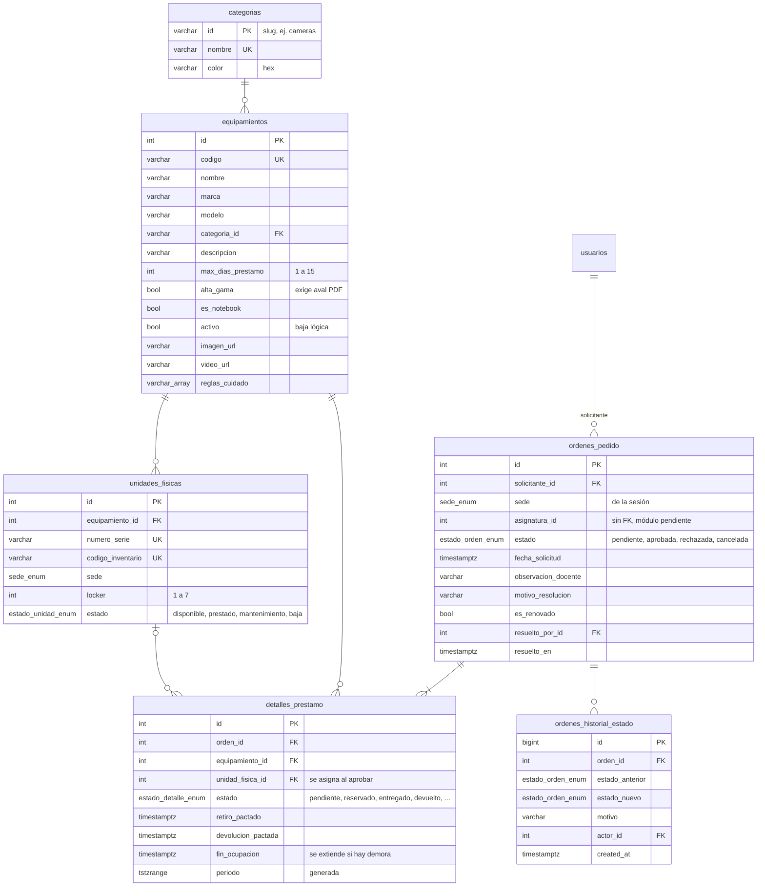
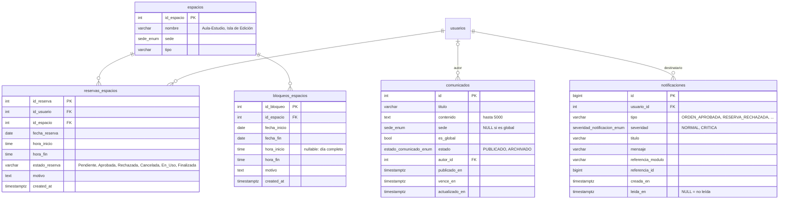

# Modelo de datos

> **Estado:** refleja los modelos de `Backend-PrestaMeDios` en `develop` (migraciones `0001`…`0014`) al 2026-11-09. Las tablas de un PR abierto se marcan como *en revisión*.
> **Diseño original:** [historico/der-v1.webp](historico/der-v1.webp) (Figura 2 del ERS). Era un DER conceptual (Chen); acá se documenta el modelo físico que existe en PostgreSQL.
> **Fuente de verdad:** `app/modules/<modulo>/models.py` y `alembic/versions/`. Si este documento y el código difieren, manda el código: corregir el documento.

## Vista general

Sólo entidades y relaciones. El detalle de columnas está en los diagramas por dominio.

**Sede** no es una tabla: es el tipo `sede_enum` (`Ushuaia`, `Río Grande`), compartido por `usuarios`, `unidades_fisicas`, `ordenes_pedido`, `espacios`, `archivos` y `comunicados`. "Ambas sedes" se representa con `sede = NULL` y es exclusivo del `SUPERADMIN` (GLO-01).

## Identidad, archivos y configuración (Perfil 1)

`tokens_recuperacion` e `intentos_recuperacion` (USR-02, migración `0015`) están **en revisión** (backend PR \#27).

## Catálogo, existencias y préstamos (Perfiles 2 y 3)

Estados de una línea de préstamo: `pendiente`, `reservado`, `entregado`, `devuelto`, `rechazado`, `no_retirado`, `cancelado`. Sólo `reservado` y `entregado` ocupan la unidad. "Demorado" y "en curso / finalizada" no se guardan: se calculan al responder.

## Espacios y comunicaciones (Perfiles 4 y 5)

`notificaciones` ya tiene tabla (migración `0013`), pero sus endpoints y la campanita son la Fase B de SPEC-06, sin implementar.

## Invariantes garantizadas por PostgreSQL

| Tabla | Restricción | Qué impide |
| --- | --- | --- |
| `detalles_prestamo` | `EXCLUDE USING gist (unidad_fisica_id =, periodo &&)` sobre líneas `reservado` o `entregado` | Prestar la misma unidad dos veces en períodos que se pisan (PRE-17) |
| `reservas_espacios` | `EXCLUDE USING gist (id_espacio =, tsrange &&)` sobre reservas `Aprobada` o `En_Uso` | Dos reservas activas del mismo espacio en la misma franja (RES-02) |
| `usuarios` | `CHECK sede_segun_rol` | Un `SUPERADMIN` con sede o un no-superadmin sin sede (GLO-01) |
| `usuarios` | `CHECK dni_numerico`, `email_minusculas`, `suspension_coherente` | Datos de cuenta inconsistentes |
| `comunicados` | `CHECK alcance_coherente` | Un comunicado global con sede o uno local sin sede |
| `equipamientos` / `unidades_fisicas` | `CHECK max_dias_prestamo 1..15`, `locker 1..7` | Valores fuera del rango del laboratorio |
| `parametros_globales` | `CHECK clave_formato`, `rango_coherente` | Claves mal formadas o rangos invertidos (GLO-03) |

Las dos `EXCLUDE` requieren la extensión `btree_gist`.

## Del DER original al modelo actual

| DER v1 | Modelo actual | Cambio |
| --- | --- | --- |
| `usuario` con subtipos `estudiante`, `docente`, `administrador` | `usuarios.rol` | Una sola tabla con rol enumerado. Se suma la distinción `SUPERADMIN` / `ADMIN_LOCAL`; el rol "Administrador ICSE" se eliminó (ADR-001) |
| `sede` (entidad) y relación `pertenece_a` | `sede_enum` en cada tabla | Sin tabla: dos valores fijos. "Ambas" = `NULL`, sólo para el `SUPERADMIN` |
| `usuario.datos_contacto`, `foto`, `estado_cuenta` | `email`, `telefono`, `foto_id` → `archivos`, `estado` + `motivo_estado` + `suspendido_hasta` | Se suman `dni`, `token_version`, `debe_cambiar_password` y dos historiales inmutables (USR-08) |
| `modelo_equipamiento` | `equipamientos` | `tipo_gama` → `alta_gama` (bool); `estado_catálogo` → `activo`; `recursos_ayuda` → `imagen_url` y `video_url`. Se suman `codigo`, `marca`, `modelo`, `es_notebook`, `max_dias_prestamo` y `reglas_cuidado`. `manual_pdf` no se implementó |
| `categoria` | `categorias` | Clave textual (slug) y `color` |
| `unidad_fisica` | `unidades_fisicas` | `codigo_interno` → `codigo_inventario` + `numero_serie`; `estado_fisico` → `estado`; se suma `sede`. `observacion_fisica` no se implementó |
| `orden_prestamo` | `ordenes_pedido` | Las fechas pasaron a cada línea. `pdf_validacion` → archivo `AVAL_PRESTAMO` en `archivos` (integración en curso). `demorado` es derivado. Se suman `sede`, `resuelto_por_id` y `resuelto_en` |
| `detalle_prestamo` | `detalles_prestamo` | Cada línea tiene estado propio, unidad asignada al aprobar y período con exclusión temporal |
| `asignatura`, relaciones `dicta` y `justifica` | `ordenes_pedido.asignatura_id` sin FK | **Pendiente:** no hay módulo de asignaturas; bloquea el panel docente (PRE-20) |
| `orden_reserva_espacio` | `reservas_espacios` | `franja_horaria` → `fecha_reserva` + `hora_inicio` / `hora_fin`. No guarda quién aprobó o rechazó |
| `Espacio_fisico` y relación `posee` | `espacios.sede` | |
| `bloqueo_espacio` | `bloqueos_espacios` | Admite día completo o franja horaria. No guarda qué administrador lo registró |
| `comunicado` | `comunicados` | Se suman `estado` (archivado) y `vence_en` |
| `notificacion` | `notificaciones` | `tipo_alerta` → `tipo` + `severidad`; `leida (b)` → `leida_en`; referencia al recurso de origen |
| `chip_comportamiento` | — | **Pendiente** (USR-09) |
| `nota_administrativa` | — | **Pendiente** (GLO-05) |
| — | `parametros_globales` (+ historial) | Nuevo: reglas operativas editables sin tocar código (GLO-03) |
| — | `archivos` / `archivos_contenido` | Nuevo: foto de perfil y aval PDF (SPEC-03 B2) |
| — | `ordenes_historial_estado` | Nuevo: traza de cada transición de una orden |
| — | `tokens_recuperacion` / `intentos_recuperacion` | Nuevo, en revisión: recuperación de contraseña (USR-02) |

## Cómo actualizar este documento

Cada migración nueva que cree o altere tablas debe venir con su cambio acá: el diagrama del dominio, la vista general si cambia una relación y la línea de **Estado**. Mermaid `erDiagram` no admite paréntesis en los tipos: usar `varchar`, `timestamptz`, etc., y poner los detalles en el comentario entre comillas.
