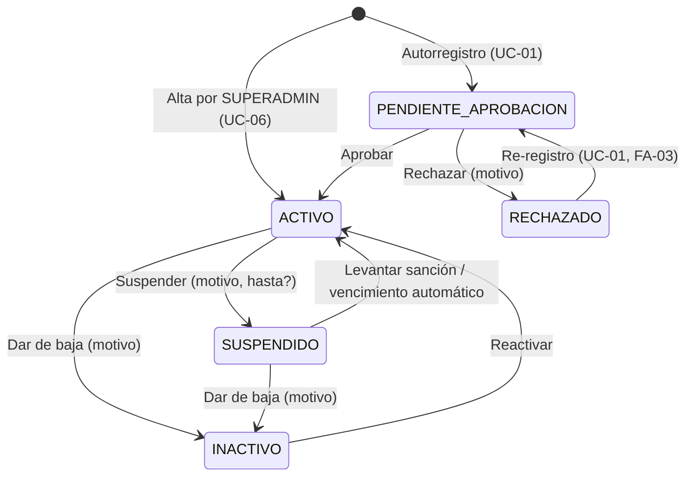
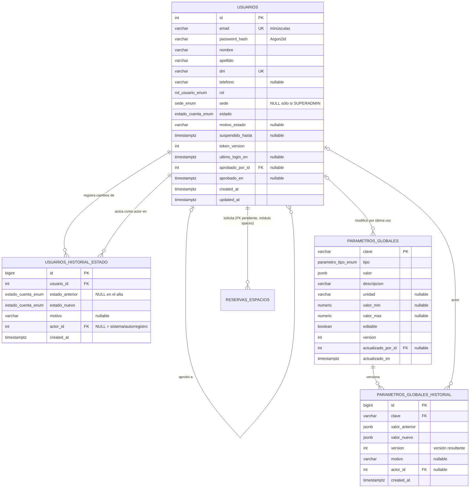

# SPEC-01 — Identidad, Autenticación, Usuarios y Parámetros Globales

| Campo | Valor |
| --- | --- |
| **ID** | SPEC-01 |
| **Perfil responsable** | Perfil 1 — Identidad, Usuarios, Permisos y Configuración Global |
| **Estado** | `IMPLEMENTADO` — 2026-10-07 (aprobado el mismo día; decisiones en §13; verificación en `specs/01-auth-users/tasks.md`) |
| **Versión** | 1.0.0 |
| **Fecha** | 2026-10-07 |
| **Requisitos cubiertos** | USR-01, USR-05, USR-04 (directorio y alta/baja lógica), GLO-01, GLO-03 |
| **Módulos backend afectados** | `app/core/` (nuevo, kernel compartido), `app/modules/users/` (nuevo), `app/modules/config/` (nuevo) |
| **Fuente de verdad funcional** | `docs/ERS.md` (ERS IEEE 830 + Casos de Uso; antes `README.md`) |
| **Gobernado por** | `docs/constitution.md` |

> **Regla SDD:** este documento está `APROBADO`; la implementación debe ajustarse a él. Cualquier cambio requiere una nueva versión registrada en la §15 (Historial) y re-aprobación.

---

## 0. Resumen ejecutivo

Este spec define el **cimiento de seguridad** de PrestaMeDios: quién es el usuario (identidad), cómo demuestra quién es (autenticación JWT), qué puede hacer (rol) y **dónde** puede hacerlo (alcance de sede). Además define el **Panel de Parámetros Globales** (GLO-03), un almacén clave-valor tipado que permite al Superadministrador ajustar reglas operativas (plazos, tolerancias, horarios) sin modificar código.

Todos los demás módulos (`inventory`, `spaces`, `loans`, `notifications`, `assistant`) dependen de los artefactos aquí definidos: la tabla `usuarios`, la dependencia `get_current_user`, el guardián de roles `require_roles(...)`, el resolvedor de alcance de sede y el servicio de lectura de parámetros.

---

## 1. Alcance

### 1.1 Dentro del alcance

| # | Capacidad | Requisito |
| --- | --- | --- |
| A1 | Autorregistro de Estudiantes y Docentes con estado inicial `PENDIENTE_APROBACION` | USR-01, USR-05 |
| A2 | Aprobación / rechazo manual de cuentas, con jurisdicción por sede | USR-05, GLO-01 |
| A3 | Inicio de sesión con emisión de JWT (access token) | USR-01 |
| A4 | Consulta de la sesión actual (`/auth/me`) | USR-01 |
| A5 | Directorio de usuarios con filtros por sede, rol, estado y búsqueda libre, con aislamiento de sede | USR-04, GLO-01 |
| A6 | Alta directa de cuentas administrativas por el Superadministrador (alcance obligatorio) | GLO-01 |
| A7 | Gestión del ciclo de vida de la cuenta: suspender (sanción), dar de baja, reactivar | USR-04, USR-05 |
| A8 | Panel de Parámetros Globales clave-valor: consulta, modificación con control de concurrencia e historial | GLO-03 |
| A9 | Kernel de seguridad reutilizable por el resto de los módulos (`get_current_user`, `require_roles`, alcance de sede) | GLO-01 |

### 1.2 Fuera del alcance (specs futuros)

| Capacidad | Requisito | Destino previsto |
| --- | --- | --- |
| Recuperación de contraseña por correo | USR-02 | SPEC-02 |
| Edición de datos de contacto y foto por el propio usuario | USR-03 | SPEC-02 |
| Edición completa de perfiles por administradores (cambio de rol/sede) | USR-04 | SPEC-02 |
| Chips de comportamiento y su relación con sanciones automáticas | USR-09 | SPEC-03 |
| Historial personal y logs de auditoría global (consultas) | USR-06/07/08 | Specs de los módulos dueños |
| Gestión dinámica del calendario / bloqueo de fechas | GLO-04 | Módulo `spaces` |
| Notas internas de administradores | GLO-05 | SPEC-03 |
| Refresh tokens, logout global, SSO institucional, rate limiting, CAPTCHA | — | Ver §13 (decisiones) |

---

## 2. Actores, roles y alcance de sede

### 2.1 Roles del sistema

| Rol (valor persistido) | Actor del ERS | Alcance de sede | Cómo se crea la cuenta |
| --- | --- | --- | --- |
| `SUPERADMIN` | Superadministrador (p. ej. Natalia Ader) | **Ambas sedes** (`sede = NULL`) | Bootstrap por CLI (§11) o alta por otro `SUPERADMIN` |
| `ADMIN_LOCAL` | Administrador Local (p. ej. Victoria — Ushuaia; Facundo — Río Grande) | Exactamente una sede | Alta por `SUPERADMIN` (UC-06) |
| `DOCENTE` | Docente | Exactamente una sede | Autorregistro (UC-01) + aprobación (UC-02), o alta por `SUPERADMIN` |
| `ESTUDIANTE` | Estudiante | Exactamente una sede | Autorregistro (UC-01) + aprobación (UC-02), o alta por `SUPERADMIN` |

> **Nota de trazabilidad:** el rol "Administrador ICSE" fue **eliminado** en la Iteración 2 (las aprobaciones del ICSE se realizan por resolución del CICSE, fuera del sistema). No debe existir en backend ni frontend.

### 2.2 Sedes

Valores canónicos (idénticos a `SedeEnum` del módulo `inventory`, ya consumidos por el frontend):

| Valor | Dirección |
| --- | --- |
| `Ushuaia` | Yrigoyen 879 |
| `Río Grande` | Thorne 302 |

"Ambas sedes" **no** es un valor de sede: se representa con `sede = NULL` y es exclusivo del rol `SUPERADMIN` (GLO-01).

---

## 3. Modelo de dominio

### 3.1 Enumeraciones

```text
RolUsuario    = SUPERADMIN | ADMIN_LOCAL | DOCENTE | ESTUDIANTE
EstadoCuenta  = PENDIENTE_APROBACION | ACTIVO | RECHAZADO | SUSPENDIDO | INACTIVO
SedeEnum      = "Ushuaia" | "Río Grande"           (reutilizado, ver D-01)
TipoParametro = ENTERO | DECIMAL | BOOLEANO | TEXTO | HORA
```

| EstadoCuenta | Significado | ¿Puede iniciar sesión? |
| --- | --- | --- |
| `PENDIENTE_APROBACION` | Autorregistrada, a la espera de validación manual (USR-05) | No |
| `ACTIVO` | Habilitada | **Sí** |
| `RECHAZADO` | Solicitud de alta denegada por un administrador | No |
| `SUSPENDIDO` | Sancionada temporal o indefinidamente (`suspendido_hasta`) | No |
| `INACTIVO` | Dada de baja (baja lógica, USR-04) | No |

### 3.2 Máquina de estados de la cuenta



**Tabla de transiciones administrativas** (endpoint `PATCH /api/v1/users/{id}/estado`). Toda transición no listada responde `409 TRANSICION_INVALIDA`.

| Desde | Hacia | Motivo | `suspendido_hasta` | Incrementa `token_version` |
| --- | --- | --- | --- | --- |
| `PENDIENTE_APROBACION` | `ACTIVO` | Opcional | Prohibido | No |
| `PENDIENTE_APROBACION` | `RECHAZADO` | **Obligatorio** | Prohibido | No |
| `ACTIVO` | `SUSPENDIDO` | **Obligatorio** | Opcional (futuro estricto) | **Sí** |
| `ACTIVO` | `INACTIVO` | **Obligatorio** | Prohibido | **Sí** |
| `SUSPENDIDO` | `ACTIVO` | Opcional | Prohibido (se limpia) | No |
| `SUSPENDIDO` | `INACTIVO` | **Obligatorio** | Prohibido (se limpia) | Sí (defensivo) |
| `INACTIVO` | `ACTIVO` | Opcional | Prohibido | No |

Cada transición (incluido el alta y las automáticas) genera una fila en `usuarios_historial_estado`.

### 3.3 Matriz de permisos (RBAC + alcance de sede)

Leyenda: ✅ permitido · 🏠 permitido sólo sobre usuarios de **su misma sede** con rol `ESTUDIANTE`/`DOCENTE` · 👁 lectura acotada a su sede · ❌ prohibido · 🌐 público (sin token)

| Operación | Público | ESTUDIANTE | DOCENTE | ADMIN_LOCAL | SUPERADMIN |
| --- | --- | --- | --- | --- | --- |
| `POST /auth/register` | 🌐 | — | — | — | — |
| `POST /auth/login` | 🌐 | — | — | — | — |
| `GET /auth/me` | ❌ | ✅ | ✅ | ✅ | ✅ |
| `GET /users` (directorio) | ❌ | ❌ | ❌ | 👁 | ✅ |
| `GET /users/{id}` | ❌ | ❌ | ❌ | 👁 | ✅ |
| `POST /users` (alta directa) | ❌ | ❌ | ❌ | ❌ | ✅ |
| `PATCH /users/{id}/estado` | ❌ | ❌ | ❌ | 🏠 | ✅ (salvo RN-15/RN-16) |
| `GET /config/parametros[/{clave}]` | ❌ | ✅ | ✅ | ✅ | ✅ |
| `GET /config/parametros/{clave}/historial` | ❌ | ❌ | ❌ | ✅ | ✅ |
| `PUT /config/parametros/{clave}` | ❌ | ❌ | ❌ | ❌ (ver D-05) | ✅ |

---

## 4. Esquema relacional

### 4.1 Diagrama Entidad-Relación



### 4.2 Entidad `usuarios`

| Columna | Tipo | Nulo | Default | Restricciones / Notas |
| --- | --- | --- | --- | --- |
| `id` | `INTEGER` identity | No | — | PK. `INTEGER` para compatibilidad con `reservas_espacios.id_usuario` |
| `email` | `VARCHAR(254)` | No | — | Único. Normalizado (trim + minúsculas) antes de persistir; `CHECK (email = lower(email))` |
| `password_hash` | `VARCHAR(255)` | No | — | Hash Argon2id (formato PHC). **Nunca** se serializa en respuestas ni logs |
| `nombre` | `VARCHAR(100)` | No | — | Trim; 1–100 caracteres |
| `apellido` | `VARCHAR(100)` | No | — | Trim; 1–100 caracteres |
| `dni` | `VARCHAR(8)` | No | — | Único. Sólo dígitos, 7–8 (ver D-03). Inmutable para el usuario (USR-03) |
| `telefono` | `VARCHAR(20)` | Sí | `NULL` | Patrón `^\+?[0-9\s-]{6,20}$` |
| `rol` | `rol_usuario_enum` | No | — | Ver §2.1 |
| `sede` | `sede_enum` | Sí | — | `NULL` ⇔ `rol = 'SUPERADMIN'` (CHECK) |
| `estado` | `estado_cuenta_enum` | No | `'PENDIENTE_APROBACION'` | Ver §3.2 |
| `motivo_estado` | `VARCHAR(500)` | Sí | `NULL` | Motivo de la última transición (rechazo/sanción/baja) |
| `suspendido_hasta` | `TIMESTAMPTZ` | Sí | `NULL` | Sólo con `estado = 'SUSPENDIDO'` (CHECK). `NULL` + `SUSPENDIDO` = suspensión indefinida |
| `token_version` | `INTEGER` | No | `0` | ≥ 0. Se incrementa para revocar todos los JWT emitidos |
| `ultimo_login_en` | `TIMESTAMPTZ` | Sí | `NULL` | Actualizado en cada login exitoso |
| `aprobado_por_id` | `INTEGER` | Sí | `NULL` | FK → `usuarios.id` `ON DELETE SET NULL` |
| `aprobado_en` | `TIMESTAMPTZ` | Sí | `NULL` | |
| `created_at` | `TIMESTAMPTZ` | No | `now()` | |
| `updated_at` | `TIMESTAMPTZ` | No | `now()` | Actualizado por ORM (`onupdate`) |

**Índices:** `ix_usuarios_sede_rol_estado (sede, rol, estado)` para el directorio; `ix_usuarios_estado_created_at (estado, created_at)` para la bandeja de pendientes.

**Política de borrado:** no existe borrado físico de usuarios. La baja es lógica (`INACTIVO`) para preservar la integridad referencial con préstamos, reservas e historiales (USR-07/USR-08).

### 4.3 Entidad `usuarios_historial_estado`

Registro inmutable (sólo `INSERT`) de cada transición de estado. Habilita la auditoría de USR-08 sin depender de logs de aplicación.

### 4.4 Entidad `parametros_globales`

Almacén clave-valor **tipado** y de **catálogo cerrado**: las claves sólo se crean/eliminan mediante migraciones Alembic del módulo dueño; la API únicamente permite leer y modificar valores. Esto evita claves huérfanas o mal escritas que la lógica de negocio nunca leería.

- `valor` se almacena como `JSONB` para conservar el tipo nativo (número, booleano, cadena).
- `valor_min` / `valor_max` aplican sólo a `ENTERO` y `DECIMAL`.
- `version` implementa **bloqueo optimista**: cada modificación exitosa la incrementa en 1.
- **Prohibido** almacenar secretos (credenciales, claves JWT, API keys): éstos viven exclusivamente en variables de entorno.

### 4.5 Entidad `parametros_globales_historial`

Registro inmutable de cada modificación de un parámetro (valor anterior, valor nuevo, versión resultante, actor y motivo).

### 4.6 DDL de referencia (PostgreSQL 15+)

> Referencia normativa para la migración Alembic `0005_users_y_parametros.py`. Los nombres de restricciones respetan la `NAMING_CONVENTION` de `app/database.py`.

```sql
-- Tipos ------------------------------------------------------------------
CREATE TYPE rol_usuario_enum    AS ENUM ('SUPERADMIN', 'ADMIN_LOCAL', 'DOCENTE', 'ESTUDIANTE');
CREATE TYPE estado_cuenta_enum  AS ENUM ('PENDIENTE_APROBACION', 'ACTIVO', 'RECHAZADO', 'SUSPENDIDO', 'INACTIVO');
CREATE TYPE parametro_tipo_enum AS ENUM ('ENTERO', 'DECIMAL', 'BOOLEANO', 'TEXTO', 'HORA');

-- sede_enum es COMPARTIDO con inventory.unidades_fisicas: crear sólo si no existe.
DO $$ BEGIN
    CREATE TYPE sede_enum AS ENUM ('Ushuaia', 'Río Grande');
EXCEPTION WHEN duplicate_object THEN NULL;
END $$;

-- usuarios ---------------------------------------------------------------
CREATE TABLE usuarios (
    id                INTEGER GENERATED BY DEFAULT AS IDENTITY,
    email             VARCHAR(254)        NOT NULL,
    password_hash     VARCHAR(255)        NOT NULL,
    nombre            VARCHAR(100)        NOT NULL,
    apellido          VARCHAR(100)        NOT NULL,
    dni               VARCHAR(8)          NOT NULL,
    telefono          VARCHAR(20),
    rol               rol_usuario_enum    NOT NULL,
    sede              sede_enum,
    estado            estado_cuenta_enum  NOT NULL DEFAULT 'PENDIENTE_APROBACION',
    motivo_estado     VARCHAR(500),
    suspendido_hasta  TIMESTAMPTZ,
    token_version     INTEGER             NOT NULL DEFAULT 0,
    ultimo_login_en   TIMESTAMPTZ,
    aprobado_por_id   INTEGER,
    aprobado_en       TIMESTAMPTZ,
    created_at        TIMESTAMPTZ         NOT NULL DEFAULT now(),
    updated_at        TIMESTAMPTZ         NOT NULL DEFAULT now(),
    CONSTRAINT pk_usuarios PRIMARY KEY (id),
    CONSTRAINT uq_usuarios_email UNIQUE (email),
    CONSTRAINT uq_usuarios_dni UNIQUE (dni),
    CONSTRAINT fk_usuarios_aprobado_por_id_usuarios
        FOREIGN KEY (aprobado_por_id) REFERENCES usuarios (id) ON DELETE SET NULL,
    CONSTRAINT ck_usuarios_email_minusculas CHECK (email = lower(email)),
    CONSTRAINT ck_usuarios_dni_numerico CHECK (dni ~ '^[0-9]{7,8}$'),
    CONSTRAINT ck_usuarios_sede_segun_rol CHECK (
        (rol = 'SUPERADMIN' AND sede IS NULL) OR (rol <> 'SUPERADMIN' AND sede IS NOT NULL)
    ),
    CONSTRAINT ck_usuarios_suspension_coherente CHECK (suspendido_hasta IS NULL OR estado = 'SUSPENDIDO'),
    CONSTRAINT ck_usuarios_token_version_no_negativa CHECK (token_version >= 0)
);
CREATE INDEX ix_usuarios_sede_rol_estado   ON usuarios (sede, rol, estado);
CREATE INDEX ix_usuarios_estado_created_at ON usuarios (estado, created_at);

-- usuarios_historial_estado ---------------------------------------------
CREATE TABLE usuarios_historial_estado (
    id               BIGINT GENERATED BY DEFAULT AS IDENTITY,
    usuario_id       INTEGER            NOT NULL,
    estado_anterior  estado_cuenta_enum,
    estado_nuevo     estado_cuenta_enum NOT NULL,
    motivo           VARCHAR(500),
    actor_id         INTEGER,
    created_at       TIMESTAMPTZ        NOT NULL DEFAULT now(),
    CONSTRAINT pk_usuarios_historial_estado PRIMARY KEY (id),
    CONSTRAINT fk_usuarios_historial_estado_usuario_id_usuarios
        FOREIGN KEY (usuario_id) REFERENCES usuarios (id) ON DELETE CASCADE,
    CONSTRAINT fk_usuarios_historial_estado_actor_id_usuarios
        FOREIGN KEY (actor_id) REFERENCES usuarios (id) ON DELETE SET NULL
);
CREATE INDEX ix_usuarios_historial_estado_usuario_id_created_at
    ON usuarios_historial_estado (usuario_id, created_at);

-- parametros_globales ----------------------------------------------------
CREATE TABLE parametros_globales (
    clave               VARCHAR(100)         NOT NULL,
    tipo                parametro_tipo_enum  NOT NULL,
    valor               JSONB                NOT NULL,
    descripcion         VARCHAR(300)         NOT NULL,
    unidad              VARCHAR(20),
    valor_min           NUMERIC,
    valor_max           NUMERIC,
    editable            BOOLEAN              NOT NULL DEFAULT true,
    version             INTEGER              NOT NULL DEFAULT 1,
    actualizado_por_id  INTEGER,
    actualizado_en      TIMESTAMPTZ          NOT NULL DEFAULT now(),
    CONSTRAINT pk_parametros_globales PRIMARY KEY (clave),
    CONSTRAINT fk_parametros_globales_actualizado_por_id_usuarios
        FOREIGN KEY (actualizado_por_id) REFERENCES usuarios (id) ON DELETE SET NULL,
    CONSTRAINT ck_parametros_globales_clave_formato
        CHECK (clave ~ '^[a-z][a-z0-9_]*(\.[a-z][a-z0-9_]*)+$'),
    CONSTRAINT ck_parametros_globales_rango_coherente
        CHECK (valor_min IS NULL OR valor_max IS NULL OR valor_min <= valor_max),
    CONSTRAINT ck_parametros_globales_version_positiva CHECK (version >= 1)
);

-- parametros_globales_historial -----------------------------------------
CREATE TABLE parametros_globales_historial (
    id              BIGINT GENERATED BY DEFAULT AS IDENTITY,
    clave           VARCHAR(100) NOT NULL,
    valor_anterior  JSONB        NOT NULL,
    valor_nuevo     JSONB        NOT NULL,
    version         INTEGER      NOT NULL,
    motivo          VARCHAR(300),
    actor_id        INTEGER,
    created_at      TIMESTAMPTZ  NOT NULL DEFAULT now(),
    CONSTRAINT pk_parametros_globales_historial PRIMARY KEY (id),
    CONSTRAINT fk_parametros_globales_historial_clave_parametros_globales
        FOREIGN KEY (clave) REFERENCES parametros_globales (clave) ON DELETE CASCADE ON UPDATE CASCADE,
    CONSTRAINT fk_parametros_globales_historial_actor_id_usuarios
        FOREIGN KEY (actor_id) REFERENCES usuarios (id) ON DELETE SET NULL
);
CREATE INDEX ix_parametros_globales_historial_clave_created_at
    ON parametros_globales_historial (clave, created_at);
```

### 4.7 Integración con el esquema existente

| Hallazgo en el repositorio | Impacto | Acción propuesta |
| --- | --- | --- |
| `reservas_espacios.id_usuario` es `INTEGER` **sin FK** | Reservas huérfanas posibles | Migración posterior a `0005`: `fk_reservas_espacios_id_usuario_usuarios` (`ON DELETE RESTRICT`). Coordinar con el dueño de `spaces` |
| `spaces` usa `id_sede: int`; `inventory` usa `SedeEnum` textual | Dos representaciones de sede: rompe el aislamiento transversal (GLO-01) | Unificar en `SedeEnum` (D-01). Coordinar con `spaces` |
| `inventory` no tiene migración Alembic propia, pero define `sede_enum` | Riesgo de `DuplicateObject` al crear el tipo | Crear `sede_enum` de forma idempotente (§4.6) y declararlo en SQLAlchemy con `create_type=False` en `users` |
| Ningún endpoint actual exige autenticación | Cualquier cliente puede crear inventario o aprobar reservas | Tras aprobar este spec, cada módulo incorpora `Depends(require_roles(...))`. Coordinar con todos los perfiles |
| Reglas fijas en código: 09:00–16:00 (`spaces/schemas.py`), `max_dias_prestamo=4` (`inventory`) | GLO-03 exige que sean configurables | Los módulos dueños leerán `config.service.obtener_parametro(...)` (§12) |

---

## 5. Casos de uso

### UC-01 — Autorregistro de cuenta (USR-01, USR-05)

- **Actor:** visitante (futuro Estudiante o Docente).
- **Precondición:** el visitante no posee una cuenta activa ni pendiente con su email o DNI.
- **Disparador:** `POST /api/v1/auth/register`.

**Flujo principal**
1. El visitante envía email, contraseña, nombre, apellido, DNI, teléfono (opcional), rol solicitado (`ESTUDIANTE` | `DOCENTE`) y sede.
2. El sistema valida el formato de todos los campos y la política de contraseñas (RN-03).
3. El sistema normaliza el email (trim + minúsculas) y verifica unicidad de email y DNI.
4. El sistema persiste la cuenta con `estado = PENDIENTE_APROBACION`, el hash Argon2id de la contraseña y la sede elegida.
5. El sistema registra la fila de historial (`NULL → PENDIENTE_APROBACION`, `actor_id = NULL`).
6. El sistema responde `201 Created` con la representación pública de la cuenta. **No emite token.**

**Flujos alternativos**
- **FA-01 — Datos inválidos:** responde `422` indicando los campos con error; no persiste nada.
- **FA-02 — Email o DNI ya registrados** en una cuenta no rechazada: responde `409 EMAIL_YA_REGISTRADO` / `409 DNI_YA_REGISTRADO`.
- **FA-03 — Re-registro tras rechazo:** si el email pertenece a una cuenta `RECHAZADO` y el DNI coincide con esa misma cuenta (o no está en uso), el sistema **reabre** la solicitud: actualiza datos y hash, vuelve a `PENDIENTE_APROBACION`, registra historial y responde `201`. (Ver D-04.)
- **FA-04 — Intento de autoasignarse privilegios** (`rol` = `ADMIN_LOCAL`/`SUPERADMIN`, o campos extra como `estado`): responde `422`.

**Postcondición:** existe una cuenta `PENDIENTE_APROBACION` visible en la bandeja de pendientes de los administradores con jurisdicción.

### UC-02 — Aprobación o rechazo de cuenta (USR-05, GLO-01)

- **Actor:** `ADMIN_LOCAL` (sólo su sede) o `SUPERADMIN` (ambas sedes).
- **Precondición:** sesión activa; cuenta objetivo en `PENDIENTE_APROBACION`.
- **Disparador:** `PATCH /api/v1/users/{id}/estado` con `nuevo_estado = ACTIVO | RECHAZADO`.

**Flujo principal (aprobación)**
1. El administrador consulta la bandeja: `GET /api/v1/users?estado=PENDIENTE_APROBACION`.
2. Selecciona la cuenta y solicita la transición a `ACTIVO`.
3. El sistema bloquea la fila (`SELECT … FOR UPDATE`), verifica jurisdicción (RN-10/RN-11) y la transición (§3.2).
4. El sistema actualiza `estado`, `aprobado_por_id`, `aprobado_en`, registra historial y responde `200`.

**Flujos alternativos**
- **FA-01 — Rechazo:** igual al principal con `nuevo_estado = RECHAZADO` y `motivo` obligatorio (`422` si falta).
- **FA-02 — Cuenta de otra sede (ADMIN_LOCAL):** `404 USUARIO_NO_ENCONTRADO` (no se revela su existencia).
- **FA-03 — Cuenta ya resuelta** (aprobación concurrente u otro estado): `409 TRANSICION_INVALIDA`.

**Postcondición:** la cuenta queda `ACTIVO` (puede iniciar sesión) o `RECHAZADO` (no puede).

### UC-03 — Inicio de sesión con JWT (USR-01, GLO-01)

- **Actor:** cualquier usuario registrado.
- **Disparador:** `POST /api/v1/auth/login`.

**Flujo principal**
1. El usuario envía email y contraseña.
2. El sistema normaliza el email y busca la cuenta.
3. El sistema verifica la contraseña contra el hash (tiempo constante, RN-06).
4. Si la cuenta está `SUSPENDIDO` con `suspendido_hasta ≤ ahora`, el sistema la reactiva automáticamente (`SUSPENDIDO → ACTIVO`, actor = sistema) — RN-09.
5. El sistema verifica `estado = ACTIVO`.
6. Si el hash usa parámetros obsoletos, lo regenera de forma transparente.
7. El sistema actualiza `ultimo_login_en`, emite el access token (§6.2) y responde `200` con el token y el perfil público (incluye `rol` y `sede`, que el frontend usa para enrutar a la interfaz del rol).

**Flujos alternativos**
- **FA-01 — Email inexistente o contraseña incorrecta:** `401 CREDENCIALES_INVALIDAS` (mensaje único, sin distinguir la causa).
- **FA-02 — Contraseña correcta, cuenta `PENDIENTE_APROBACION`:** `403 CUENTA_PENDIENTE_APROBACION`.
- **FA-03 — Contraseña correcta, cuenta `RECHAZADO`:** `403 CUENTA_RECHAZADA`.
- **FA-04 — Contraseña correcta, cuenta `SUSPENDIDO` vigente:** `403 CUENTA_SUSPENDIDA` (incluye `suspendido_hasta` si existe).
- **FA-05 — Contraseña correcta, cuenta `INACTIVO`:** `403 CUENTA_INACTIVA`.
- **FA-06 — "Olvidé mi contraseña":** deriva a USR-02 (SPEC-02).

> El estado de la cuenta **sólo** se revela después de verificar la contraseña. Con contraseña incorrecta, toda cuenta responde `401` (RN-07).

### UC-04 — Consultar sesión actual

- **Actor:** usuario autenticado.
- **Disparador:** `GET /api/v1/auth/me`.
- **Flujo:** el sistema valida el token (§6.2) y devuelve el perfil público **leído de la base de datos** (no de los claims).
- **Uso:** rehidratar la sesión del frontend al recargar la página y detectar revocaciones.

### UC-05 — Directorio de usuarios con filtrado por sede (USR-04, GLO-01)

- **Actor:** `ADMIN_LOCAL` o `SUPERADMIN`.
- **Disparador:** `GET /api/v1/users`.

**Flujo principal**
1. El administrador solicita el directorio con filtros opcionales: `sede`, `rol`, `estado`, `q`, paginación y orden.
2. El sistema resuelve el **alcance efectivo de sede** (RN-10):
   - `SUPERADMIN` sin `sede` → ambas sedes (incluye otros `SUPERADMIN`).
   - `SUPERADMIN` con `sede` → sólo esa sede (excluye `SUPERADMIN`, cuya sede es `NULL`).
   - `ADMIN_LOCAL` sin `sede` o con su propia sede → sólo su sede.
   - `ADMIN_LOCAL` con otra sede → `403 SEDE_FUERA_DE_ALCANCE`.
3. El sistema aplica el resto de los filtros **dentro** del alcance efectivo y devuelve la página solicitada con el total.

**Flujos alternativos**
- **FA-01 — Sin resultados:** `200` con `items: []` y `total: 0`.
- **FA-02 — Rol no administrativo:** `403 PERMISO_INSUFICIENTE`.

### UC-06 — Alta directa de cuenta por el Superadministrador (GLO-01)

- **Actor:** `SUPERADMIN`.
- **Disparador:** `POST /api/v1/users`.

**Flujo principal**
1. El Superadministrador envía los datos de la cuenta, el `rol` y el **alcance** (`sede`): `Ushuaia`, `Río Grande` o `null` ("Ambas sedes").
2. El sistema valida la coherencia rol–alcance (RN-02): "Ambas sedes" ⇔ `SUPERADMIN`.
3. El sistema crea la cuenta directamente en `ACTIVO`, con `aprobado_por_id` = actor, y registra historial.
4. Responde `201` con el detalle de la cuenta.

**Flujos alternativos**
- **FA-01 — Rol no permitido para el actor** (`ADMIN_LOCAL` u otro): `403 PERMISO_INSUFICIENTE`.
- **FA-02 — Alcance incoherente** (p. ej. `ADMIN_LOCAL` sin sede): `422`.
- **FA-03 — Email/DNI duplicado:** `409`.

> La contraseña inicial la define el Superadministrador y se comunica por canal externo. El cambio obligatorio en el primer ingreso queda para SPEC-02 (USR-02/USR-03).

### UC-07 — Suspensión, baja y reactivación de cuentas (USR-04, USR-05)

- **Actor:** `ADMIN_LOCAL` (sólo `ESTUDIANTE`/`DOCENTE` de su sede) o `SUPERADMIN`.
- **Disparador:** `PATCH /api/v1/users/{id}/estado` con `nuevo_estado = SUSPENDIDO | INACTIVO | ACTIVO`.

**Flujo principal**
1. El administrador selecciona la cuenta y la transición deseada, indicando `motivo` (obligatorio para suspender/dar de baja) y opcionalmente `suspendido_hasta`.
2. El sistema verifica jurisdicción, reglas de protección (RN-14 a RN-16) y transición válida.
3. Si la cuenta abandona `ACTIVO`, el sistema incrementa `token_version`: **todas las sesiones abiertas quedan revocadas de inmediato** (RN-08).
4. El sistema registra historial y responde `200`.

**Flujos alternativos**
- **FA-01 — Operación sobre la propia cuenta:** `403 OPERACION_SOBRE_SI_MISMO`.
- **FA-02 — Dejaría al sistema sin `SUPERADMIN` activo:** `409 ULTIMO_SUPERADMIN`.
- **FA-03 — `ADMIN_LOCAL` sobre un administrador de su sede:** `403 PERMISO_INSUFICIENTE`.
- **FA-04 — `suspendido_hasta` en el pasado:** `422`.

### UC-08 — Consultar parámetros globales (GLO-03)

- **Actor:** cualquier usuario autenticado y activo.
- **Disparador:** `GET /api/v1/config/parametros` o `GET /api/v1/config/parametros/{clave}`.
- **Flujo:** el sistema devuelve los parámetros con su tipo, valor, unidad, rango, descripción, versión y metadatos de última modificación. El frontend los usa para restringir calendarios y formularios (p. ej. horario 09:00–16:00, máximo de días).
- **FA-01:** clave inexistente → `404 PARAMETRO_NO_ENCONTRADO`.

### UC-09 — Modificar un parámetro global (GLO-03)

- **Actor:** `SUPERADMIN` (ver D-05).
- **Disparador:** `PUT /api/v1/config/parametros/{clave}`.

**Flujo principal**
1. El Superadministrador abre el panel, edita el valor y confirma, enviando `valor`, la `version` que estaba viendo y un `motivo` opcional.
2. El sistema bloquea la fila, verifica que el parámetro sea `editable` y que `version` coincida con la persistida.
3. El sistema valida el valor según `tipo`, `valor_min`/`valor_max` y reglas cruzadas (RN-20).
4. El sistema persiste el nuevo valor, incrementa `version`, registra `actualizado_por_id`/`actualizado_en` y una fila de historial.
5. Responde `200` con el parámetro actualizado. El cambio rige **para operaciones nuevas** a partir de ese instante (RN-21).

**Flujos alternativos**
- **FA-01 — Otro administrador lo modificó antes:** `409 CONFLICTO_VERSION` (incluye la versión vigente); el panel debe recargar.
- **FA-02 — Valor fuera de tipo o rango:** `422 VALOR_PARAMETRO_INVALIDO`.
- **FA-03 — Inconsistencia cruzada** (p. ej. apertura ≥ cierre): `422 PARAMETROS_INCONSISTENTES`.
- **FA-04 — Parámetro no editable:** `409 PARAMETRO_NO_EDITABLE`.
- **FA-05 — Valor idéntico al actual:** `200` sin cambios, sin incrementar versión ni generar historial (operación idempotente).

---

## 6. Contratos de API

### 6.1 Convenciones generales

| Aspecto | Convención |
| --- | --- |
| Base path | `/api/v1` (consistente con `inventory` y `spaces`) |
| Formato | `application/json; charset=utf-8`, campos en `snake_case` (el frontend los espeja 1:1 en sus DTOs) |
| Autenticación | Header `Authorization: Bearer <access_token>` (esquema OpenAPI `HTTPBearer`) |
| Fechas | ISO-8601 con zona horaria, persistidas en UTC (`2026-10-07T13:45:00Z`) |
| Validación de entrada | Pydantic v2 con `extra="forbid"` y `str_strip_whitespace=True` (patrón `_INPUT_CONFIG` del módulo `inventory`) |
| Errores de validación | `422` con el formato **estándar de FastAPI** (`{"detail": [ {loc, msg, type} ]}`); no se altera globalmente |
| Errores de negocio | `{"detail": "<mensaje legible en español>", "code": "<CODIGO_MAQUINA>"}`; `detail` sigue siendo `string`, compatible con el manejo actual del frontend (`body.detail`) |
| Paginación | `limit` (1–100, default 20) y `offset` (≥ 0, default 0); respuesta envolvente `{items, total, limit, offset}` |
| Tags OpenAPI | `Autenticación`, `Usuarios`, `Configuración Global` |

### 6.2 Esquema de seguridad JWT

| Aspecto | Definición |
| --- | --- |
| Tipo | Access token JWS firmado; sin refresh token en esta versión (D-06) |
| Algoritmo | `HS256`; se rechaza cualquier otro valor de `alg` (incluido `none`) |
| Secreto | `JWT_SECRET_KEY` (env, ≥ 32 bytes aleatorios). La app **no arranca** si falta |
| Expiración | `JWT_ACCESS_TOKEN_EXPIRE_MINUTES` (env, default `60`); tolerancia de reloj 30 s |
| Emisor | `iss = "prestamedios-api"` (validado) |
| Librerías | `PyJWT` (tokens) y `pwdlib[argon2]` (hash Argon2id) — reemplazan a `python-jose`/`passlib`, sin mantenimiento activo |

**Claims del token**

```json
{
  "sub": "42",
  "rol": "ADMIN_LOCAL",
  "sede": "Ushuaia",
  "tv": 3,
  "iss": "prestamedios-api",
  "iat": 1791380700,
  "exp": 1791384300,
  "jti": "5b0e3f1c-6a7e-4b8e-9a51-3c2d7f0a9e11"
}
```

**Validación en cada request protegida (`get_current_user`)**

| Paso | Falla | Respuesta |
| --- | --- | --- |
| 1. Header presente y con esquema `Bearer` | No | `401 NO_AUTENTICADO` + `WWW-Authenticate: Bearer` |
| 2. Firma, `alg`, `iss` válidos | No | `401 TOKEN_INVALIDO` |
| 3. `exp` vigente | No | `401 TOKEN_EXPIRADO` |
| 4. Usuario `sub` existe | No | `401 TOKEN_INVALIDO` |
| 5. `tv` == `usuarios.token_version` y `estado = ACTIVO` | No | `401 TOKEN_REVOCADO` |
| 6. Autorización por rol (`require_roles`) | No | `403 PERMISO_INSUFICIENTE` |

> `rol` y `sede` en el token son **informativos** (para el frontend). La autorización siempre usa los valores **vigentes en base de datos**, por lo que un cambio de rol, sede o estado surte efecto inmediato.

### 6.3 Resumen de endpoints

| Método | Ruta | Auth | Caso de uso | Éxito |
| --- | --- | --- | --- | --- |
| `POST` | `/api/v1/auth/register` | Pública | UC-01 | `201` |
| `POST` | `/api/v1/auth/login` | Pública | UC-03 | `200` |
| `GET` | `/api/v1/auth/me` | Bearer | UC-04 | `200` |
| `GET` | `/api/v1/users` | `ADMIN_LOCAL`, `SUPERADMIN` | UC-05 | `200` |
| `GET` | `/api/v1/users/{id}` | `ADMIN_LOCAL`, `SUPERADMIN` | UC-05 | `200` |
| `POST` | `/api/v1/users` | `SUPERADMIN` | UC-06 | `201` |
| `PATCH` | `/api/v1/users/{id}/estado` | `ADMIN_LOCAL`, `SUPERADMIN` | UC-02, UC-07 | `200` |
| `GET` | `/api/v1/config/parametros` | Bearer | UC-08 | `200` |
| `GET` | `/api/v1/config/parametros/{clave}` | Bearer | UC-08 | `200` |
| `PUT` | `/api/v1/config/parametros/{clave}` | `SUPERADMIN` | UC-09 | `200` |
| `GET` | `/api/v1/config/parametros/{clave}/historial` | `ADMIN_LOCAL`, `SUPERADMIN` | UC-09 | `200` |

### 6.4 Esquemas compartidos (respuestas)

**`UsuarioPublico`** — perfil propio (`/register`, `/login`, `/me`)

| Campo | Tipo | Notas |
| --- | --- | --- |
| `id` | `int` | |
| `email` | `string` | En minúsculas |
| `nombre` | `string` | |
| `apellido` | `string` | |
| `dni` | `string` | |
| `telefono` | `string \| null` | |
| `rol` | `RolUsuario` | |
| `sede` | `SedeEnum \| null` | `null` = ambas sedes |
| `estado` | `EstadoCuenta` | |
| `created_at` | `datetime` | |

**`UsuarioResumen`** — ítem del directorio: `id`, `email`, `nombre`, `apellido`, `dni`, `rol`, `sede`, `estado`, `created_at`.

**`UsuarioDetalle`** — vista administrativa: `UsuarioPublico` + `motivo_estado`, `suspendido_hasta`, `ultimo_login_en`, `aprobado_por_id`, `aprobado_en`, `updated_at`.

**`PaginaUsuarios`** — `{ "items": UsuarioResumen[], "total": int, "limit": int, "offset": int }`.

**`Parametro`**

| Campo | Tipo | Notas |
| --- | --- | --- |
| `clave` | `string` | p. ej. `prestamo.general.max_dias` |
| `tipo` | `TipoParametro` | |
| `valor` | `int \| number \| bool \| string` | Tipo nativo según `tipo`; `HORA` como `"HH:MM"` |
| `descripcion` | `string` | |
| `unidad` | `string \| null` | `días`, `horas`… |
| `valor_min` / `valor_max` | `number \| null` | |
| `editable` | `bool` | |
| `version` | `int` | Necesario para el `PUT` |
| `actualizado_por_id` | `int \| null` | |
| `actualizado_en` | `datetime` | |

**`ErrorNegocio`** — `{ "detail": string, "code": string }` (más campos contextuales opcionales, p. ej. `suspendido_hasta`, `version_actual`).

### 6.5 `POST /api/v1/auth/register`

**Request — `RegistroRequest`**

| Campo | Tipo | Req. | Reglas |
| --- | --- | --- | --- |
| `email` | `string` | Sí | Email válido (RFC 5322, `EmailStr`), ≤ 254; se normaliza a minúsculas |
| `password` | `string` | Sí | RN-03 |
| `nombre` | `string` | Sí | 1–100, letras (con acentos/ñ), espacios, `'` y `-` |
| `apellido` | `string` | Sí | Ídem `nombre` |
| `dni` | `string` | Sí | `^\d{7,8}$` |
| `telefono` | `string \| null` | No | `^\+?[0-9\s-]{6,20}$` |
| `rol` | `"ESTUDIANTE" \| "DOCENTE"` | Sí | Cualquier otro valor → `422` |
| `sede` | `"Ushuaia" \| "Río Grande"` | Sí | `null` u otro valor → `422` |

```json
{
  "email": "Lucia.Perez@untdf.edu.ar",
  "password": "Camara2026!",
  "nombre": "Lucía",
  "apellido": "Pérez",
  "dni": "40123456",
  "telefono": "+54 2901 555123",
  "rol": "ESTUDIANTE",
  "sede": "Ushuaia"
}
```

**Response `201` — `UsuarioPublico`**

```json
{
  "id": 42,
  "email": "lucia.perez@untdf.edu.ar",
  "nombre": "Lucía",
  "apellido": "Pérez",
  "dni": "40123456",
  "telefono": "+54 2901 555123",
  "rol": "ESTUDIANTE",
  "sede": "Ushuaia",
  "estado": "PENDIENTE_APROBACION",
  "created_at": "2026-10-07T13:45:00Z"
}
```

| Código | `code` | Cuándo |
| --- | --- | --- |
| `201` | — | Cuenta creada o reabierta (FA-03) en `PENDIENTE_APROBACION` |
| `409` | `EMAIL_YA_REGISTRADO` | Email en uso por una cuenta no rechazada |
| `409` | `DNI_YA_REGISTRADO` | DNI en uso por otra cuenta no rechazada |
| `422` | — (formato FastAPI) | Campos inválidos, faltantes, extra, rol/sede no permitidos, contraseña débil |

### 6.6 `POST /api/v1/auth/login`

**Request — `LoginRequest`**: `{ "email": string (EmailStr), "password": string (1–128) }`.

> No se aplica la política de complejidad en el login (sólo longitud), para no revelar reglas ni bloquear cuentas con hashes antiguos.

**Response `200` — `TokenResponse`**

```json
{
  "access_token": "eyJhbGciOiJIUzI1NiIsInR5cCI6IkpXVCJ9...",
  "token_type": "bearer",
  "expires_in": 3600,
  "usuario": { "id": 42, "email": "lucia.perez@untdf.edu.ar", "nombre": "Lucía", "apellido": "Pérez",
               "dni": "40123456", "telefono": null, "rol": "ESTUDIANTE", "sede": "Ushuaia",
               "estado": "ACTIVO", "created_at": "2026-10-07T13:45:00Z" }
}
```

| Código | `code` | Cuándo |
| --- | --- | --- |
| `200` | — | Credenciales válidas y cuenta `ACTIVO` |
| `401` | `CREDENCIALES_INVALIDAS` | Email inexistente o contraseña incorrecta (cualquier estado) |
| `403` | `CUENTA_PENDIENTE_APROBACION` | Contraseña correcta, cuenta pendiente |
| `403` | `CUENTA_RECHAZADA` | Contraseña correcta, cuenta rechazada |
| `403` | `CUENTA_SUSPENDIDA` | Contraseña correcta, sanción vigente. Body incluye `suspendido_hasta` (`null` = indefinida) |
| `403` | `CUENTA_INACTIVA` | Contraseña correcta, cuenta dada de baja |
| `422` | — | Payload inválido |

```json
{ "detail": "Tu cuenta está suspendida hasta el 2026-10-20.", "code": "CUENTA_SUSPENDIDA", "suspendido_hasta": "2026-10-20T03:00:00Z" }
```

### 6.7 `GET /api/v1/auth/me`

| Código | `code` | Cuándo |
| --- | --- | --- |
| `200` | — | `UsuarioPublico` del usuario autenticado |
| `401` | `NO_AUTENTICADO` / `TOKEN_INVALIDO` / `TOKEN_EXPIRADO` / `TOKEN_REVOCADO` | Ver §6.2 |

### 6.8 `GET /api/v1/users`

**Query params**

| Param | Tipo | Default | Reglas |
| --- | --- | --- | --- |
| `sede` | `SedeEnum` | — | Ver alcance efectivo (UC-05, RN-10) |
| `rol` | `RolUsuario` | — | |
| `estado` | `EstadoCuenta` | — | `PENDIENTE_APROBACION` = bandeja de validación |
| `q` | `string` | — | 2–100 caracteres; `ILIKE` sobre nombre, apellido, email y DNI; `%` y `_` se escapan (búsqueda literal) |
| `ordenar_por` | `"apellido" \| "created_at"` | `apellido` | Desempate por `id` |
| `direccion` | `"asc" \| "desc"` | `asc` | |
| `limit` | `int` | `20` | 1–100 |
| `offset` | `int` | `0` | ≥ 0 |

**Response `200` — `PaginaUsuarios`**

```json
{
  "items": [
    { "id": 42, "email": "lucia.perez@untdf.edu.ar", "nombre": "Lucía", "apellido": "Pérez",
      "dni": "40123456", "rol": "ESTUDIANTE", "sede": "Ushuaia",
      "estado": "PENDIENTE_APROBACION", "created_at": "2026-10-07T13:45:00Z" }
  ],
  "total": 1, "limit": 20, "offset": 0
}
```

| Código | `code` | Cuándo |
| --- | --- | --- |
| `200` | — | Página (posiblemente vacía) dentro del alcance efectivo |
| `401` | `NO_AUTENTICADO` / `TOKEN_*` | Token ausente o inválido |
| `403` | `PERMISO_INSUFICIENTE` | Rol `ESTUDIANTE` o `DOCENTE` |
| `403` | `SEDE_FUERA_DE_ALCANCE` | `ADMIN_LOCAL` filtra explícitamente por otra sede |
| `422` | — | Parámetros fuera de rango |

### 6.9 `GET /api/v1/users/{id}`

| Código | `code` | Cuándo |
| --- | --- | --- |
| `200` | — | `UsuarioDetalle` |
| `403` | `PERMISO_INSUFICIENTE` | Rol no administrativo |
| `404` | `USUARIO_NO_ENCONTRADO` | No existe **o** está fuera del alcance del `ADMIN_LOCAL` (RN-11) |

### 6.10 `POST /api/v1/users`

**Request — `UsuarioAdminCreate`**: mismos campos que `RegistroRequest`, con `rol: RolUsuario` (los cuatro) y `sede: SedeEnum | null`.

| Regla | Error |
| --- | --- |
| `rol = SUPERADMIN` ⇒ `sede = null`; otro rol ⇒ `sede` obligatoria | `422` |

| Código | `code` | Cuándo |
| --- | --- | --- |
| `201` | — | `UsuarioDetalle` con `estado = ACTIVO` |
| `403` | `PERMISO_INSUFICIENTE` | Actor no es `SUPERADMIN` |
| `409` | `EMAIL_YA_REGISTRADO` / `DNI_YA_REGISTRADO` | Duplicados |
| `422` | — | Validación |

### 6.11 `PATCH /api/v1/users/{id}/estado`

**Request — `CambioEstadoRequest`**

| Campo | Tipo | Req. | Reglas |
| --- | --- | --- | --- |
| `nuevo_estado` | `"ACTIVO" \| "RECHAZADO" \| "SUSPENDIDO" \| "INACTIVO"` | Sí | `PENDIENTE_APROBACION` no es destino válido por API |
| `motivo` | `string \| null` | Cond. | 3–500. Obligatorio para `RECHAZADO`, `SUSPENDIDO`, `INACTIVO` |
| `suspendido_hasta` | `datetime \| null` | No | Sólo con `SUSPENDIDO`; debe ser futuro |

```json
{ "nuevo_estado": "SUSPENDIDO", "motivo": "Devolución con 3 días de demora (Res. CICSE 056/2023).", "suspendido_hasta": "2026-10-20T03:00:00Z" }
```

| Código | `code` | Cuándo |
| --- | --- | --- |
| `200` | — | `UsuarioDetalle` actualizado |
| `403` | `PERMISO_INSUFICIENTE` | Rol no admin, o `ADMIN_LOCAL` sobre un administrador |
| `403` | `OPERACION_SOBRE_SI_MISMO` | `id` = usuario autenticado |
| `404` | `USUARIO_NO_ENCONTRADO` | Inexistente o fuera de la sede del `ADMIN_LOCAL` |
| `409` | `TRANSICION_INVALIDA` | Transición no permitida por §3.2 (incluye mismo estado) |
| `409` | `ULTIMO_SUPERADMIN` | Dejaría 0 `SUPERADMIN` en `ACTIVO` |
| `422` | — | Motivo faltante, `suspendido_hasta` pasado o con estado ≠ `SUSPENDIDO` |

### 6.12 `GET /api/v1/config/parametros` y `GET /api/v1/config/parametros/{clave}`

| Código | `code` | Cuándo |
| --- | --- | --- |
| `200` | — | `Parametro[]` ordenado por `clave` / `Parametro` |
| `401` | `NO_AUTENTICADO` / `TOKEN_*` | |
| `404` | `PARAMETRO_NO_ENCONTRADO` | Clave inexistente |

### 6.13 `PUT /api/v1/config/parametros/{clave}`

**Request — `ParametroUpdate`**

| Campo | Tipo | Req. | Reglas |
| --- | --- | --- | --- |
| `valor` | `int \| number \| bool \| string` | Sí | Debe coincidir **estrictamente** con `tipo` (RN-19) |
| `version` | `int` | Sí | ≥ 1; debe igualar la versión persistida |
| `motivo` | `string \| null` | No | ≤ 300 |

```json
{ "valor": 3, "version": 1, "motivo": "Temporada alta de rodajes: se acorta el plazo general." }
```

| Código | `code` | Cuándo |
| --- | --- | --- |
| `200` | — | `Parametro` actualizado (o sin cambios si el valor es idéntico) |
| `403` | `PERMISO_INSUFICIENTE` | Actor no es `SUPERADMIN` |
| `404` | `PARAMETRO_NO_ENCONTRADO` | |
| `409` | `CONFLICTO_VERSION` | `version` desactualizada; body incluye `version_actual` |
| `409` | `PARAMETRO_NO_EDITABLE` | `editable = false` |
| `422` | `VALOR_PARAMETRO_INVALIDO` | Tipo o rango inválido |
| `422` | `PARAMETROS_INCONSISTENTES` | Viola una regla cruzada (RN-20) |

### 6.14 `GET /api/v1/config/parametros/{clave}/historial`

Response `200`: lista (más reciente primero, `limit` ≤ 100) de `{ version, valor_anterior, valor_nuevo, motivo, actor_id, created_at }`. Errores: `403 PERMISO_INSUFICIENTE`, `404 PARAMETRO_NO_ENCONTRADO`.

### 6.15 Catálogo de códigos de error

| `code` | HTTP | Mensaje sugerido (`detail`) |
| --- | --- | --- |
| `NO_AUTENTICADO` | 401 | Se requiere iniciar sesión. |
| `TOKEN_INVALIDO` | 401 | La sesión no es válida. Iniciá sesión nuevamente. |
| `TOKEN_EXPIRADO` | 401 | La sesión expiró. Iniciá sesión nuevamente. |
| `TOKEN_REVOCADO` | 401 | La sesión fue cerrada por un cambio en tu cuenta. |
| `CREDENCIALES_INVALIDAS` | 401 | Email o contraseña incorrectos. |
| `CUENTA_PENDIENTE_APROBACION` | 403 | Tu cuenta está pendiente de aprobación por la administración del Laboratorio. |
| `CUENTA_RECHAZADA` | 403 | Tu solicitud de cuenta fue rechazada. |
| `CUENTA_SUSPENDIDA` | 403 | Tu cuenta está suspendida[ hasta el …]. |
| `CUENTA_INACTIVA` | 403 | Tu cuenta está dada de baja. |
| `PERMISO_INSUFICIENTE` | 403 | No tenés permisos para realizar esta acción. |
| `SEDE_FUERA_DE_ALCANCE` | 403 | No tenés jurisdicción sobre la sede solicitada. |
| `OPERACION_SOBRE_SI_MISMO` | 403 | No podés modificar el estado de tu propia cuenta. |
| `USUARIO_NO_ENCONTRADO` | 404 | Usuario no encontrado. |
| `PARAMETRO_NO_ENCONTRADO` | 404 | Parámetro no encontrado. |
| `EMAIL_YA_REGISTRADO` | 409 | Ya existe una cuenta con ese email. |
| `DNI_YA_REGISTRADO` | 409 | Ya existe una cuenta con ese DNI. |
| `TRANSICION_INVALIDA` | 409 | La cuenta no admite el cambio de estado solicitado. |
| `ULTIMO_SUPERADMIN` | 409 | Debe existir al menos un Superadministrador activo. |
| `CONFLICTO_VERSION` | 409 | El parámetro fue modificado por otra persona. Recargá el panel. |
| `PARAMETRO_NO_EDITABLE` | 409 | Este parámetro no puede modificarse desde el panel. |
| `VALOR_PARAMETRO_INVALIDO` | 422 | El valor no respeta el tipo o rango permitido. |
| `PARAMETROS_INCONSISTENTES` | 422 | El valor genera una configuración inconsistente. |

---

## 7. Reglas de negocio

| ID | Regla |
| --- | --- |
| RN-01 | El autorregistro sólo admite los roles `ESTUDIANTE` y `DOCENTE`. Las cuentas administrativas se crean exclusivamente por `SUPERADMIN` (UC-06) o por bootstrap (§11). |
| RN-02 | `sede = NULL` ⇔ `rol = SUPERADMIN` ("Ambas sedes"). Todo otro rol tiene exactamente una sede. Se garantiza en Pydantic **y** con `CHECK` en base de datos. |
| RN-03 | Política de contraseña: 8–128 caracteres, al menos una letra y un dígito, distinta del email. Se almacena sólo el hash Argon2id. |
| RN-04 | El email se normaliza (trim + minúsculas) antes de validar unicidad, persistir o autenticar. |
| RN-05 | Email y DNI son únicos en todo el sistema (ambas sedes). |
| RN-06 | La verificación de contraseña es de tiempo constante; si el email no existe se verifica contra un hash ficticio para igualar tiempos de respuesta. |
| RN-07 | El estado de la cuenta sólo se revela tras verificar correctamente la contraseña. |
| RN-08 | Toda transición que abandona `ACTIVO`, y todo cambio futuro de rol o sede, incrementa `token_version`, revocando de inmediato los tokens emitidos. |
| RN-09 | Una suspensión con `suspendido_hasta` vencido se levanta automáticamente en el siguiente intento de login (evaluación perezosa; actor = sistema). |
| RN-10 | Alcance efectivo de sede: `SUPERADMIN` → ambas o la filtrada; `ADMIN_LOCAL` → siempre la propia; `ESTUDIANTE`/`DOCENTE` → sin acceso al directorio. |
| RN-11 | Un recurso de otra sede se responde como **inexistente** (`404`) para el `ADMIN_LOCAL`, sin revelar su existencia. El `403 SEDE_FUERA_DE_ALCANCE` se reserva para filtros explícitos del cliente. |
| RN-12 | El `ADMIN_LOCAL` sólo puede cambiar el estado de cuentas `ESTUDIANTE`/`DOCENTE` de su sede. |
| RN-13 | Los cambios de estado se serializan con bloqueo de fila (`SELECT … FOR UPDATE`) para evitar resoluciones concurrentes contradictorias. |
| RN-14 | Rechazar, suspender o dar de baja requiere `motivo`. |
| RN-15 | Ningún usuario puede cambiar el estado de su propia cuenta. |
| RN-16 | Debe existir siempre al menos un `SUPERADMIN` en `ACTIVO`. |
| RN-17 | No hay borrado físico de usuarios; la baja es lógica (`INACTIVO`). |
| RN-18 | El catálogo de parámetros es cerrado: claves creadas sólo por migración; la API no permite crear ni eliminar claves. |
| RN-19 | Validación estricta de tipos: `ENTERO` rechaza booleanos y decimales (`true`, `4.0`); `DECIMAL` acepta enteros y decimales, no booleanos; `HORA` exige `HH:MM` (00:00–23:59); `BOOLEANO` sólo `true`/`false`; `TEXTO` 1–300 caracteres. |
| RN-20 | Reglas cruzadas: `horario.apertura` < `horario.cierre`; `prestamo.general.max_dias` ≤ `prestamo.notebook.max_dias`; `solicitud.anticipacion_min_horas` < 24 × `reserva_espacio.anticipacion_max_dias` (la ventana de solicitud nunca queda vacía). |
| RN-21 | Un cambio de parámetro rige para operaciones **nuevas**; no altera retroactivamente solicitudes ya registradas o aprobadas. |
| RN-22 | Toda modificación de estado de usuario o de parámetro deja traza inmutable en su tabla de historial, en la misma transacción. |
| RN-23 | Prohibido almacenar secretos en `parametros_globales`. |

---

## 8. Criterios de aceptación

> Formato Gherkin. Cada criterio se traduce en al menos un test automatizado (`pytest` + `httpx.AsyncClient`) contra PostgreSQL de pruebas.

### 8.1 Registro (UC-01)

```gherkin
AC-01  Registro exitoso queda pendiente
  Dado que no existe una cuenta con email "lucia.perez@untdf.edu.ar" ni DNI "40123456"
  Cuando envío POST /auth/register con datos válidos, rol "ESTUDIANTE" y sede "Ushuaia"
  Entonces recibo 201 con estado "PENDIENTE_APROBACION" y sin access_token
  Y la base contiene el hash Argon2id y no la contraseña en claro
  Y existe una fila de historial NULL → PENDIENTE_APROBACION con actor NULL

AC-02  El email se normaliza
  Cuando me registro con "  Lucia.PEREZ@UNTDF.edu.ar "
  Entonces la cuenta queda con email "lucia.perez@untdf.edu.ar"
  Y un segundo registro con "lucia.perez@untdf.edu.ar" recibe 409 EMAIL_YA_REGISTRADO

AC-03  No se pueden autoasignar privilegios
  Cuando me registro con rol "ADMIN_LOCAL" o "SUPERADMIN"
  Entonces recibo 422
  Cuando me registro agregando el campo "estado": "ACTIVO"
  Entonces recibo 422 y no se crea ninguna cuenta

AC-04  Sede obligatoria y válida
  Cuando me registro sin sede, con sede null o con sede "Ambas sedes"
  Entonces recibo 422

AC-05  Contraseña débil
  Cuando me registro con password "abcdefgh" o "1234567" o igual a mi email
  Entonces recibo 422

AC-06  Re-registro tras rechazo
  Dado que mi cuenta fue RECHAZADA
  Cuando me registro nuevamente con el mismo email y DNI
  Entonces recibo 201, la cuenta vuelve a PENDIENTE_APROBACION con el mismo id
  Y se registra la transición RECHAZADO → PENDIENTE_APROBACION
```

### 8.2 Aprobación y ciclo de vida (UC-02, UC-07)

```gherkin
AC-07  ADMIN_LOCAL aprueba una cuenta de su sede
  Dado un ADMIN_LOCAL de "Ushuaia" y una cuenta PENDIENTE de "Ushuaia"
  Cuando envía PATCH /users/{id}/estado con nuevo_estado "ACTIVO"
  Entonces recibe 200, la cuenta queda ACTIVO con aprobado_por_id = ADMIN_LOCAL
  Y el usuario puede iniciar sesión

AC-08  ADMIN_LOCAL no ve ni actúa sobre otra sede
  Dado un ADMIN_LOCAL de "Ushuaia" y una cuenta PENDIENTE de "Río Grande"
  Cuando consulta GET /users/{id} o envía PATCH /users/{id}/estado
  Entonces recibe 404 USUARIO_NO_ENCONTRADO y la cuenta no cambia

AC-09  SUPERADMIN aprueba en ambas sedes
  Dado un SUPERADMIN y cuentas PENDIENTES en "Ushuaia" y "Río Grande"
  Cuando aprueba ambas
  Entonces recibe 200 en ambos casos

AC-10  Rechazo exige motivo
  Cuando un administrador rechaza sin motivo
  Entonces recibe 422 y la cuenta sigue PENDIENTE_APROBACION

AC-11  Aprobación concurrente
  Dado que dos administradores aprueban la misma cuenta simultáneamente
  Entonces exactamente uno recibe 200 y el otro 409 TRANSICION_INVALIDA
  Y existe una sola fila de historial PENDIENTE_APROBACION → ACTIVO

AC-12  Suspensión revoca sesiones abiertas
  Dado un ESTUDIANTE ACTIVO con un token válido
  Cuando un administrador lo suspende
  Entonces la siguiente request del estudiante con ese token recibe 401 TOKEN_REVOCADO

AC-13  Protecciones
  Cuando un administrador intenta cambiar su propio estado → 403 OPERACION_SOBRE_SI_MISMO
  Cuando un ADMIN_LOCAL intenta suspender a otro ADMIN_LOCAL de su sede → 403 PERMISO_INSUFICIENTE
  Cuando se intenta dar de baja al único SUPERADMIN activo → 409 ULTIMO_SUPERADMIN
  Cuando se solicita INACTIVO → SUSPENDIDO → 409 TRANSICION_INVALIDA

AC-14  Alta de administradores con alcance obligatorio
  Dado un SUPERADMIN
  Cuando crea un ADMIN_LOCAL con sede "Río Grande" → 201, estado ACTIVO
  Cuando crea un ADMIN_LOCAL sin sede → 422
  Cuando crea un SUPERADMIN con sede "Ushuaia" → 422
  Dado un ADMIN_LOCAL, cuando intenta POST /users → 403 PERMISO_INSUFICIENTE
```

### 8.3 Login JWT (UC-03, UC-04)

```gherkin
AC-15  Login exitoso
  Dado un usuario ACTIVO
  Cuando envía credenciales correctas
  Entonces recibe 200 con access_token, token_type "bearer", expires_in = 3600 y su perfil
  Y el token contiene sub, rol, sede, tv, iss, iat, exp, jti
  Y GET /auth/me con ese token devuelve su perfil

AC-16  Credenciales inválidas indistinguibles
  Cuando el email no existe, o existe con contraseña incorrecta (en cualquier estado)
  Entonces recibe 401 CREDENCIALES_INVALIDAS con idéntico detail

AC-17  Cuentas no activas con contraseña correcta
  PENDIENTE_APROBACION → 403 CUENTA_PENDIENTE_APROBACION
  RECHAZADO            → 403 CUENTA_RECHAZADA
  SUSPENDIDO vigente   → 403 CUENTA_SUSPENDIDA con suspendido_hasta
  INACTIVO             → 403 CUENTA_INACTIVA
  Y en ningún caso se emite token

AC-18  Fin automático de la sanción
  Dado un usuario SUSPENDIDO con suspendido_hasta en el pasado
  Cuando inicia sesión con credenciales correctas
  Entonces recibe 200, su estado pasa a ACTIVO
  Y existe historial SUSPENDIDO → ACTIVO con actor NULL

AC-19  Tokens inválidos
  Sin header → 401 NO_AUTENTICADO con WWW-Authenticate: Bearer
  Firma alterada, alg "none" o iss distinto → 401 TOKEN_INVALIDO
  Token expirado → 401 TOKEN_EXPIRADO
```

### 8.4 Directorio y aislamiento de sede (UC-05)

```gherkin
AC-20  Aislamiento del ADMIN_LOCAL
  Dado 3 usuarios en "Ushuaia", 2 en "Río Grande" y 1 SUPERADMIN
  Cuando un ADMIN_LOCAL de "Ushuaia" consulta GET /users sin filtros
  Entonces total = 3 y ningún item tiene sede distinta de "Ushuaia"
  Cuando consulta GET /users?sede=Río%20Grande
  Entonces recibe 403 SEDE_FUERA_DE_ALCANCE

AC-21  Vista del SUPERADMIN
  Cuando un SUPERADMIN consulta GET /users → total = 6
  Cuando consulta GET /users?sede=Río%20Grande → total = 2

AC-22  Filtros combinados y bandeja de pendientes
  Cuando un administrador consulta GET /users?estado=PENDIENTE_APROBACION&rol=DOCENTE
  Entonces sólo recibe docentes pendientes dentro de su alcance

AC-23  Búsqueda literal y paginación
  Cuando busca q="%" → recibe sólo coincidencias literales del carácter "%"
  Cuando pide limit=101 → 422
  Cuando pide limit=2&offset=2 → recibe la segunda página y el total completo

AC-24  Roles sin acceso
  Cuando un ESTUDIANTE o DOCENTE consulta GET /users → 403 PERMISO_INSUFICIENTE
```

### 8.5 Parámetros globales (UC-08, UC-09)

```gherkin
AC-25  Lectura por cualquier usuario activo
  Dado un ESTUDIANTE autenticado
  Cuando consulta GET /config/parametros
  Entonces recibe 200 con todas las claves semilla (§11.2) y sus valores tipados

AC-26  Modificación exitosa
  Dado un SUPERADMIN y "prestamo.general.max_dias" = 4 con version 1
  Cuando envía PUT con valor 3 y version 1
  Entonces recibe 200 con valor 3 y version 2
  Y existe historial 4 → 3 (version 2) con actor = SUPERADMIN

AC-27  Bloqueo optimista
  Dado que la versión vigente es 2
  Cuando se envía PUT con version 1 → 409 CONFLICTO_VERSION con version_actual = 2

AC-28  Validación de tipo, rango y coherencia
  ENTERO con valor true, 4.0 o "4" → 422 VALOR_PARAMETRO_INVALIDO
  "prestamo.general.max_dias" con valor 0 o 16 → 422 VALOR_PARAMETRO_INVALIDO
  "horario.apertura" con valor "16:30" siendo cierre "16:00" → 422 PARAMETROS_INCONSISTENTES
  "horario.cierre" con valor "25:00" → 422 VALOR_PARAMETRO_INVALIDO

AC-29  Permisos de escritura
  Cuando un ADMIN_LOCAL, DOCENTE o ESTUDIANTE envía PUT → 403 PERMISO_INSUFICIENTE

AC-30  Catálogo cerrado
  Cuando se envía PUT a una clave inexistente → 404 PARAMETRO_NO_ENCONTRADO
  Y no existe endpoint para crear ni eliminar claves
```

---

## 9. Casos de borde

| ID | Escenario | Comportamiento esperado | Respuesta |
| --- | --- | --- | --- |
| EC-01 | Usuario **sancionado** (`SUSPENDIDO` vigente) intenta autenticarse con contraseña correcta | Se rechaza sin emitir token; se informa la fecha de fin si existe | `403 CUENTA_SUSPENDIDA` |
| EC-02 | Usuario sancionado intenta autenticarse con contraseña **incorrecta** | No se revela el estado | `401 CREDENCIALES_INVALIDAS` |
| EC-03 | Usuario **inactivo** (dado de baja) intenta autenticarse | Rechazo sin token | `403 CUENTA_INACTIVA` |
| EC-04 | Usuario suspendido **mientras tiene sesión abierta** | `token_version` incrementado; la próxima request falla | `401 TOKEN_REVOCADO` |
| EC-05 | Suspensión vencida al momento del login | Reactivación automática y login exitoso | `200` |
| EC-06 | Suspensión indefinida (`suspendido_hasta = NULL`) | Sólo un administrador puede levantarla | `403 CUENTA_SUSPENDIDA` (`suspendido_hasta: null`) |
| EC-07 | `ADMIN_LOCAL` de Ushuaia filtra el directorio por Río Grande | Rechazo explícito | `403 SEDE_FUERA_DE_ALCANCE` |
| EC-08 | `ADMIN_LOCAL` de Ushuaia accede por ID a un usuario de Río Grande (enumeración de IDs) | Se responde como inexistente | `404 USUARIO_NO_ENCONTRADO` |
| EC-09 | `ADMIN_LOCAL` busca `rol=SUPERADMIN` | El filtro opera dentro de su alcance: no hay resultados | `200`, `total: 0` |
| EC-10 | `SUPERADMIN` filtra por una sede concreta | Los `SUPERADMIN` (sede `NULL`) no aparecen | `200` |
| EC-11 | Rol o sede del usuario cambian con sesión abierta (SPEC-02) | Revocación por `token_version`; autorización siempre con datos vigentes | `401 TOKEN_REVOCADO` |
| EC-12 | Dos registros simultáneos con el mismo email | La restricción `UNIQUE` resuelve la carrera; `IntegrityError` → 409 | `201` / `409` |
| EC-13 | Dos administradores resuelven la misma solicitud simultáneamente | Bloqueo de fila; el segundo encuentra el estado ya cambiado | `200` / `409 TRANSICION_INVALIDA` |
| EC-14 | Email con mayúsculas/espacios en login | Se normaliza antes de buscar | Igual que el email normalizado |
| EC-15 | Token firmado con `alg: none` o con otro secreto | Rechazo | `401 TOKEN_INVALIDO` |
| EC-16 | Token de un usuario cuyo `sub` no existe | Rechazo | `401 TOKEN_INVALIDO` |
| EC-17 | Último `SUPERADMIN` activo intenta ser dado de baja o suspendido por otro (o la cuenta queda sola) | Rechazo | `409 ULTIMO_SUPERADMIN` |
| EC-18 | Cambio de `prestamo.general.max_dias` de 4 a 3 con préstamos de 4 días ya aprobados | Los existentes no se alteran; sólo las nuevas solicitudes usan 3 | — |
| EC-19 | Dos `SUPERADMIN` editan el mismo parámetro a la vez | El segundo recibe conflicto y debe recargar | `409 CONFLICTO_VERSION` |
| EC-20 | Valor booleano para un parámetro `ENTERO` (en Python `bool` es subclase de `int`) | Rechazo explícito | `422 VALOR_PARAMETRO_INVALIDO` |
| EC-21 | Cuenta `PENDIENTE` con sede equivocada | El administrador la rechaza con motivo; el usuario se re-registra (FA-03). La edición de sede por admin llega en SPEC-02 | — |
| EC-22 | Payload con campos desconocidos en cualquier endpoint de escritura | Rechazo (protección contra *mass assignment*) | `422` |

---

## 10. Requisitos no funcionales

| ID | Categoría | Requisito |
| --- | --- | --- |
| NFR-01 | Seguridad | Hash Argon2id con parámetros por defecto de `pwdlib`; rehash transparente al cambiar parámetros. |
| NFR-02 | Seguridad | Contraseñas, hashes y tokens **nunca** se registran en logs ni se devuelven en respuestas. |
| NFR-03 | Seguridad | `JWT_SECRET_KEY` sólo por variable de entorno; nunca versionado. `.env.example` documenta las variables sin valores reales. |
| NFR-04 | Seguridad | CORS restringido a `CORS_ORIGINS` (mecanismo ya existente en `main.py`). |
| NFR-05 | Rendimiento | `GET /users` p95 < 300 ms con 5 000 usuarios (índices §4.2). Login p95 < 800 ms (dominado por Argon2). |
| NFR-06 | Disponibilidad | La validación de token implica 1 lectura por PK por request; aceptable para el volumen previsto (< 1 000 usuarios activos). |
| NFR-07 | Calidad | Cobertura ≥ 85 % en `app/core`, `app/modules/users` y `app/modules/config`; todos los AC de §8 automatizados. |
| NFR-08 | Calidad | Tests de integración contra PostgreSQL real (base `prestamedios_test`), por el uso de `ENUM`, `JSONB`, `CHECK` y bloqueos de fila. |
| NFR-09 | Documentación | Todos los endpoints con `summary`, `response_model`, ejemplos y respuestas de error declaradas en OpenAPI (consumido también por el futuro agente MCP). |
| NFR-10 | Observabilidad | Logs estructurados de login fallido (email normalizado, IP, causa genérica) y de cambios de estado/parámetros (actor, objetivo). |

---

## 11. Bootstrap y datos semilla

### 11.1 Superadministrador inicial

- Se crea con un comando CLI idempotente: `python -m app.modules.users.cli crear-superadmin --email <email> --nombre <n> --apellido <a> --dni <dni>`; la contraseña se solicita por prompt oculto o se lee de `BOOTSTRAP_SUPERADMIN_PASSWORD`.
- **Prohibido** sembrar credenciales por defecto en migraciones o código.
- Si ya existe un `SUPERADMIN` activo con ese email, el comando no hace nada y lo informa.

### 11.2 Parámetros semilla (migración `0005`)

| Clave | Tipo | Valor | Mín | Máx | Unidad | Origen |
| --- | --- | --- | --- | --- | --- | --- |
| `prestamo.general.max_dias` | ENTERO | `4` | 1 | 15 | días | PRE-07, Def. Préstamo General |
| `prestamo.notebook.max_dias` | ENTERO | `15` | 1 | 30 | días | Def. Préstamo de Notebooks |
| `solicitud.anticipacion_min_horas` | ENTERO | `24` | 0 | 168 | horas | Restricciones — Tiempos límite (D-07): anticipación mínima entre el envío de una solicitud (préstamo o reserva de espacio) y el inicio del retiro/turno |
| `prestamo.tolerancia_retiro_horas` | ENTERO | `2` | 0 | 24 | horas | PRE-08 |
| `notificacion.aviso_vencimiento_horas` | ENTERO | `24` | 1 | 168 | horas | NOV-03 |
| `horario.apertura` | HORA | `"09:00"` | — | — | — | Restricciones — Horarios fijos, GLO-02 |
| `horario.cierre` | HORA | `"16:00"` | — | — | — | Restricciones — Horarios fijos, GLO-02 |
| `reserva_espacio.anticipacion_max_dias` | ENTERO | `120` | 1 | 365 | días | GLO-03 ("ventanas de anticipación"); UI actual: "hasta 4 meses a futuro" |

Todas con `editable = true`, `version = 1`, `actualizado_por_id = NULL`.

---

## 12. Impacto en otros módulos y contrato interno

### 12.1 Artefactos que provee este spec al resto del equipo

| Artefacto | Ubicación propuesta | Uso |
| --- | --- | --- |
| `Settings` (pydantic-settings) | `app/core/settings.py` | Variables de entorno tipadas |
| `hash_password`, `verify_password`, `crear_access_token`, `decodificar_token` | `app/core/security.py` | Uso interno de `users` |
| `get_current_user` → `Usuario` | `app/core/deps.py` | `Depends` en cualquier endpoint protegido |
| `require_roles(*roles)` | `app/core/deps.py` | `Depends(require_roles(RolUsuario.ADMIN_LOCAL, RolUsuario.SUPERADMIN))` |
| `resolver_alcance_sede(usuario, sede_solicitada) -> list[SedeEnum]` | `app/core/deps.py` | Filtrar bandejas, inventario y calendarios por jurisdicción (PRE-15, RES-05, NOV-02) |
| `AppError` + handler | `app/core/errors.py` | Errores `{detail, code}` homogéneos |
| `SedeEnum`, `RolUsuario` | `app/core/enums.py` | Enums transversales (ver D-01) |
| `obtener_parametro(db, clave) -> int \| float \| bool \| str \| time` | `app/modules/config/service.py` | Lectura tipada de parámetros (horario, plazos, tolerancias) |

### 12.2 Coordinación requerida

| Módulo / Perfil | Acción | Prioridad |
| --- | --- | --- |
| `spaces` | Migrar `id_sede: int` → `sede: SedeEnum`; FK `id_usuario → usuarios.id`; tomar `id_usuario` del token (no del body); leer horario de `config`; rechazar reservas cuyo inicio sea anterior a `ahora + solicitud.anticipacion_min_horas` (D-07) | Alta |
| `inventory` | Importar `SedeEnum` desde `app/core/enums.py` (re-export temporal para no romper); proteger altas/cambios de estado con `require_roles`; sede automática para `ADMIN_LOCAL` (PRE-19) | Alta |
| `loans` | Usar `obtener_parametro` para plazos, tolerancias y anticipación mínima (`solicitud.anticipacion_min_horas`, D-07); filtrar bandeja con `resolver_alcance_sede` | Media |
| Frontend | Reemplazar `Role = "student" \| "teacher" \| "admin" \| "icse"` por espejo de `RolUsuario`; eliminar `icse`; `AuthContext` + interceptor `Authorization` en `inventoryApi`/`spacesApi`; manejar `401 TOKEN_*` cerrando sesión | Alta |

---

## 13. Decisiones resueltas

> Aprobadas por el Perfil 1 el 2026-10-07. Las marcadas como **ajustadas** fueron definidas explícitamente en la revisión; el resto adopta la recomendación del borrador 0.1.0.

| ID | Decisión | Resolución | Fundamento |
| --- | --- | --- | --- |
| D-01 | Representación canónica de sede | `SedeEnum` textual compartido en `app/core/enums.py` | Ya lo usan `inventory` y el frontend; sólo hay 2 sedes fijas por reglamento. `spaces` migra (coordinación §12.2) |
| D-02 | Dominio de email — **ajustada** | **No se exige email institucional**: se acepta cualquier dominio válido | Muchos estudiantes usan correos personales; la validación manual de USR-05 mitiga el riesgo de cuentas falsas |
| D-03 | Documento de identidad | DNI numérico de 7–8 dígitos | Caso general de la comunidad UNTDF; se revisará si aparecen estudiantes sin DNI argentino |
| D-04 | Destino de una cuenta rechazada — **ajustada** | La cuenta se **conserva en `RECHAZADO`** (no se borra) y puede re-registrarse (UC-01 FA-03). Se modificó el CU "Registro y validación de cuentas" del ERS (entonces `README.md`, hoy `Backend-PrestaMeDios/docs/ERS.md`) | Preserva auditoría (USR-08) y la integridad del historial de estados |
| D-05 | Quién edita parámetros globales | Sólo `SUPERADMIN`; `ADMIN_LOCAL` puede consultar el historial | Los parámetros afectan a ambas sedes; permitirlo a un local violaría el aislamiento (GLO-01) |
| D-06 | Refresh tokens / logout | Sólo access token de 60 min en esta versión; refresh token en cookie `HttpOnly` se evalúa en SPEC-02 | Simplicidad para la entrega del 40 % |
| D-07 | Interpretación de "plazos máximos y mínimos (24 horas)" — **ajustada** | Es la **anticipación mínima de la solicitud**: una solicitud (préstamo o reserva de espacio) debe enviarse con al menos 24 h de antelación al inicio del retiro/turno. Parámetro `solicitud.anticipacion_min_horas` (§11.2) | Definido por el Perfil 1 en la revisión. La validación la aplican `loans` y `spaces` leyendo el parámetro (§12.2) |
| D-08 | Usuario sancionado | Se bloquea el login (`403 CUENTA_SUSPENDIDA`) | Simplicidad y claridad en v1; el modo lectura se reevaluará con USR-06 |
| D-09 | Formato del listado del directorio | Envolvente paginada `{items, total, limit, offset}` | El directorio crece con cada cohorte |

---

## 14. Matriz de trazabilidad

| Requisito | Casos de uso | Endpoints | Criterios | Bordes |
| --- | --- | --- | --- | --- |
| USR-01 | UC-01, UC-03, UC-04 | `/auth/register`, `/auth/login`, `/auth/me` | AC-01…06, AC-15…19 | EC-02, EC-12, EC-14…16 |
| USR-05 | UC-01, UC-02 | `/auth/register`, `PATCH /users/{id}/estado` | AC-01, AC-06…11 | EC-13, EC-21 |
| USR-04 (parcial) | UC-05, UC-07 | `GET /users`, `GET /users/{id}`, `PATCH /users/{id}/estado` | AC-12, AC-13, AC-20…24 | EC-01, EC-03…06, EC-17 |
| GLO-01 | UC-02, UC-05, UC-06 | `GET /users`, `POST /users` | AC-08, AC-09, AC-14, AC-20, AC-21 | EC-07…11 |
| GLO-03 | UC-08, UC-09 | `/config/parametros/*` | AC-25…30 | EC-18…20 |

---

## 15. Historial de cambios

| Versión | Fecha | Autor | Cambio |
| --- | --- | --- | --- |
| 1.0.0 | 2026-10-07 | Perfil 1 | **Implementado** en `Backend-PrestaMeDios` (rama `feat/users-core`), sin cambios de contrato respecto de la versión aprobada. |
| 1.0.0 | 2026-10-07 | Perfil 1 | **Aprobado.** Decisiones resueltas (§13). D-02: sin restricción de dominio de email. D-04: cuentas rechazadas se conservan (README actualizado). D-07: el parámetro `prestamo.min_horas` se reemplaza por `solicitud.anticipacion_min_horas` (anticipación mínima de la solicitud) y se ajusta la regla cruzada RN-20 |
| 0.1.0 | 2026-10-07 | Perfil 1 (con asistencia de IA) | Borrador inicial para revisión |
